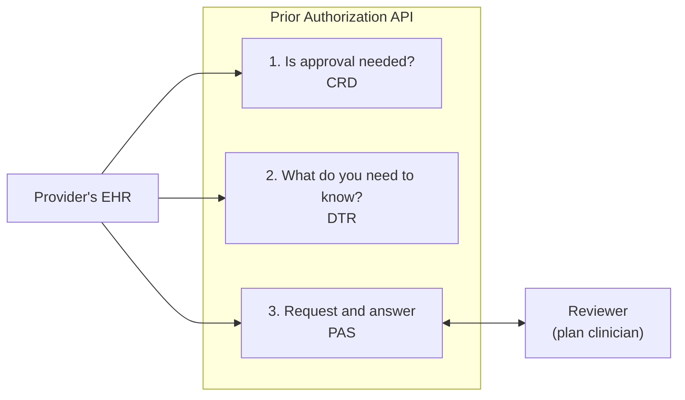

# Prior Authorization API

A payer-side FHIR Prior Authorization API for a California county Medi-Cal behavioral health plan, written in C# on ASP.NET Core.

It lets a contracted provider's software ask the plan for approval before delivering a service and get the plan's answer, system to system. It exists to meet the Prior Authorization API requirement of the CMS Interoperability and Prior Authorization Final Rule (CMS-0057-F), which DHCS applies to county Mental Health Plans and DMC-ODS plans through BHIN 26-008.

## Status

**In development. Not deployable.** It works end to end on a developer machine with synthetic data.

| Area | State |
|---|---|
| Submit a request, check status, read the answer (Da Vinci PAS) | Working: one service per request; no update, cancel or appeal |
| Ask whether an order needs approval (Da Vinci CRD) | Working, basic: two of six hooks, no eligibility check |
| Download the questionnaire for a service (Da Vinci DTR) | Working, basic: no automatic filling of answers |
| Sign-in for provider systems (SMART Backend Services) | Working: one server instance only; keys registered as a fixed set, no JWKS URL |
| Supporting documents | Working |
| Staff portal: review queue, decisions, provider systems | Working: staff sign in with Windows (roles from AD groups), or as test users in Development; no audit log yet |
| SQL Server with migrations | Working |
| Deadlines and notices, audit log, hosting on IIS, conformance testing | Not started |
| Service list and questions | Built from the DHCS notices; codes and questionnaires await the plan's confirmation |

Do not put real member information in it. See [status and open questions](docs/04-status-and-open-questions.md) for what is missing and what was assumed.

On 2026-11-11 the code was audited against the CMS Prior Authorization API workflow and the Da Vinci guides, and the findings that could be fixed in code were fixed. The findings and what remains open are in [the November 2026 audit](docs/07-audit-2026-11.md).

## How it works in one picture



A person at the plan decides every request. The API carries the request in and the decision out.

## Quick start

You need the .NET 10 SDK. Run these from the repository root.

Start the service. The reviewer queue is at http://localhost:5020:

```bash
dotnet run --project src/PriorAuth.Api --no-launch-profile -- --urls http://localhost:5020 --environment Development
```

### Demo for management

The clinic demo acts as a provider's system: it asks about an order, downloads the questionnaire, submits a request with answers and a document, and waits for the decision. It shows each step in a browser, in plain words, so it also works for people who are not developers. Every step is a real call to the service; only the clinic, the member and the suggested answers are made up. With the service running as above, start it in a second terminal and open http://localhost:5030:

```bash
dotnet run --project samples/PriorAuth.ClinicDemo
```

1. Put the clinic demo and the staff portal (http://localhost:5020) side by side. The portal asks you to pick a test user: choose **Lee Clinician (test)**, who can approve and deny.
2. **Pick a service** from the plan's list on the left. Therapeutic behavioral services (TBS) is a good first run: it needs approval.
3. **Check with the plan.** The plan answers in under a second whether approval is needed.
4. **Get the plan's form.** The plan's questions appear, filled in from the clinic's pretend record. Change any answer; a required question left blank stops the request until it is answered.
5. **Send the request.** It appears in the reviewer queue, with the answers exactly as sent.
6. In the portal, open the request, press **Claim it**, choose an end date and approve it (or approve with changes, or deny it with a reason from the list). Within a few seconds the clinic demo shows the decision and the authorization number. **Switch test user** shows what a coordinator or an admin sees instead.

Other services show the plan's other rules:

| Pick | What the audience sees |
|---|---|
| Crisis residential treatment | No approval needed, and the plan may not require it. No form. A request sent anyway is answered at once. |
| Acute psychiatric inpatient | No approval beforehand: the stay is reviewed after admission. The admission and the plan's form still go to the review queue. |
| ASAM 3.1 residential | The order check needs a person, because an order cannot carry the billing modifier that names the level. The request, which does carry it, goes to review. |
| Adult residential treatment | Held for a person, because its code is shared with the DMC-ODS residential levels. |

**Start again** begins a new request. Each step has a closed "Technical detail" section for questions about what was sent. The demo registers itself as a provider system the way a plan admin would, signing in as the test admin, so the service must run in the Development environment.

#### Running the demo on a demo server

In the Development environment anyone who reaches the portal can sign in as any test user, so the service only accepts the host name `localhost` and listens on this machine alone. Run both apps on the demo server and present from that server's own desktop (signed in at the console or over Remote Desktop), with the browser pointed at `localhost`. Do not use a shared host such as a terminal server or Citrix: every user signed in there could reach it.

1. **Install the .NET 10 SDK** on the server, then get the code onto it, from git or a copied folder:

   ```powershell
   git clone https://github.com/tngo0508/prior-auth-api.git
   cd prior-auth-api
   ```

   To check out work that is not merged yet, add `git checkout <branch>`.

2. **Start the service** in one window. It runs in Development mode, which is correct for a demo: synthetic data, a local SQLite file, and no https address to configure. Delete the old database first so the demo starts empty and on the current data model:

   ```powershell
   Remove-Item src/PriorAuth.Api/priorauth.db -ErrorAction SilentlyContinue
   dotnet run --project src/PriorAuth.Api --no-launch-profile -- --urls http://localhost:5020 --environment Development
   ```

3. **Start the clinic demo** in a second window:

   ```powershell
   dotnet run --project samples/PriorAuth.ClinicDemo
   ```

4. **Open two browser windows on the server**, side by side: http://localhost:5030 (the clinic) and http://localhost:5020 (the staff portal). Follow the script above.

To use other ports, pass `--urls` to either app and point the demo at the service with `--PlanApi`, for example `dotnet run --project samples/PriorAuth.ClinicDemo -- --urls http://localhost:6030 --PlanApi http://localhost:6020`.

Before each audience, stop the service, delete `src/PriorAuth.Api/priorauth.db`, and start it again to clear earlier requests. Restart the clinic demo too, or press **Start again**.

Run the tests:

```bash
dotnet test
```

If a command fails with "address already in use" or "file is locked", a copy is already running; stop it with Ctrl+C in its terminal. If the service fails with "no such table", delete `src/PriorAuth.Api/priorauth.db` and start it again.

## Documentation

Start with the architecture overview for the whole system on one page, then the guides in order. Developers changing the code should read the codebase guide (8) next.

| Document | What it covers |
|---|---|
| [Architecture overview](docs/architecture.md) | Actors, components, request flow, data, access control, technology, deployment, decisions and gaps |
| [1. Overview](docs/01-overview.md) | What the API is, where the requirement comes from, the vocabulary |
| [2. How it works](docs/02-how-it-works.md) | The request rules, the code map, the FHIR mapping |
| [3. Running and testing](docs/03-running-and-testing.md) | Running everything, every endpoint, the tests, SQL Server |
| [4. Status and open questions](docs/04-status-and-open-questions.md) | What is done, missing and assumed |
| [5. Sign-in for provider systems](docs/05-sign-in.md) | How a provider's system proves who it is |
| [6. Asking first: CRD and DTR](docs/06-crd-and-dtr.md) | How an EHR learns that approval is needed and what to send |
| [7. November 2026 audit](docs/07-audit-2026-11.md) | What the audit against the CMS workflow found, and what was fixed |
| [8. Codebase guide for developers](docs/08-codebase-guide.md) | Start-up, pipeline, every endpoint and class, data mapping, sign-in and CRD/DTR internals, tests, recipes and traps |
| [9. The service list](docs/09-service-list.md) | Which services need approval, the DHCS sources, how codes and modifiers are matched, and what the plan must confirm |
| [GLOSSARY.md](GLOSSARY.md) | The project's business terms |

For developers of provider systems, the running service also serves a guide at `/developers.html`.

## Repository layout

| Path | Contents |
|---|---|
| [src/PriorAuth.Api](src/PriorAuth.Api) | The service |
| [tests/PriorAuth.Api.Tests](tests/PriorAuth.Api.Tests) | 190 automated tests, almost all starting the real app; they run on SQLite or SQL Server |
| [samples/PriorAuth.ClinicDemo](samples/PriorAuth.ClinicDemo) | A browser demo of one request, in plain words, for management |
| [docs](docs) | Documentation, diagrams and screenshots |

Inside the service:

| Folder | Responsibility |
|---|---|
| `Domain` | The authorization request, its states and every business rule |
| `Fhir` | PAS endpoints and the translation between FHIR and the domain |
| `Crd` | CDS Hooks services |
| `Dtr` | Questionnaires |
| `Review` | The reviewer queue and decisions |
| `Auth` | Registration and sign-in for provider systems |
| `Data` | Database mapping and migrations |
| `service-requirements.json` | The plan's service list: each service's code, modifiers, review rule (prior authorization, concurrent review or none) and questionnaire, and the shared questionnaires. Checked at start-up: a malformed code, a duplicate entry or a missing questionnaire stops the service from starting |

## Technology

.NET 10 and ASP.NET Core, the Firely SDK for FHIR R4, Entity Framework Core with SQLite for development and SQL Server for production, and xUnit. Standards targeted: FHIR R4.0.1; Da Vinci PAS, CRD and DTR at STU 2.0.1; SMART Backend Services; CDS Hooks.

## References

- [CMS-0057-F fact sheet](https://www.cms.gov/newsroom/fact-sheets/cms-interoperability-prior-authorization-final-rule-cms-0057-f)
- [DHCS BHIN 26-008](https://www.dhcs.ca.gov/Documents/BHIN-26-008-Interoperability-Requirements-for-MHPs-and-DMC-ODS.pdf)
- [Da Vinci Prior Authorization Support (PAS)](https://hl7.org/fhir/us/davinci-pas/)
- [Da Vinci Coverage Requirements Discovery (CRD)](https://hl7.org/fhir/us/davinci-crd/)
- [Da Vinci Documentation Templates and Rules (DTR)](https://hl7.org/fhir/us/davinci-dtr/)

Work is tracked in this repository's [GitHub issues](https://github.com/tngo0508/prior-auth-api/issues).
