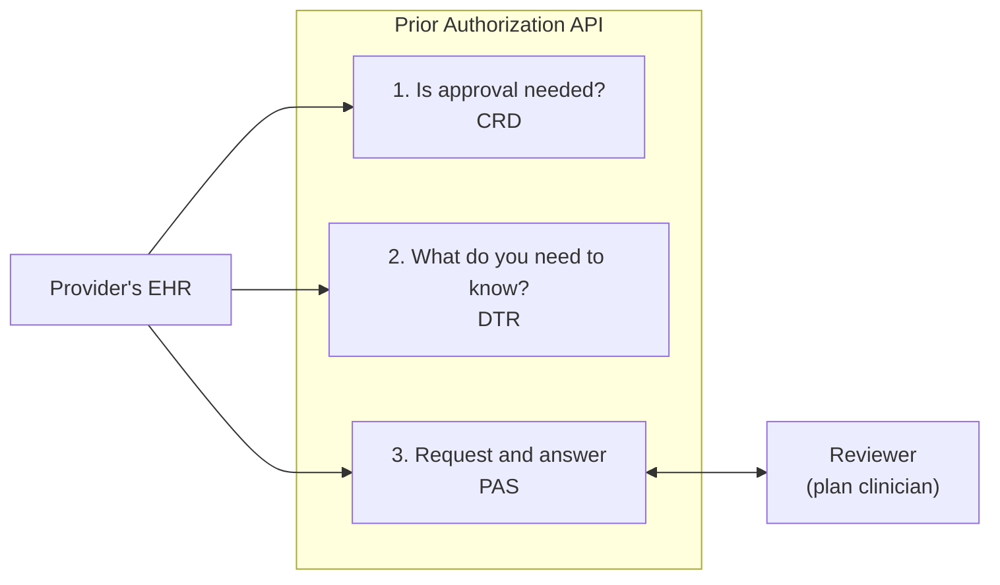

# Prior Authorization API

A payer-side FHIR Prior Authorization API for a California county Medi-Cal behavioral health plan, written in C# on ASP.NET Core.

It lets a contracted provider's software ask the plan for approval before delivering a service and get the plan's answer, system to system. It exists to meet the Prior Authorization API requirement of the CMS Interoperability and Prior Authorization Final Rule (CMS-0057-F), which DHCS applies to county Mental Health Plans and DMC-ODS plans through BHIN 26-008.

## Status

**In development. Not deployable.** It works end to end on a developer machine with synthetic data.

| Area | State |
|---|---|
| Submit a request, check status, read the answer (Da Vinci PAS) | Working: one service per request; no update, cancel or appeal |
| Ask whether an order needs approval (Da Vinci CRD) | Working, basic: two of six hooks, no eligibility check |
| Download the questionnaire for a service (Da Vinci DTR) | Working, basic: no automatic filling of answers |
| Sign-in for provider systems (SMART Backend Services) | Working: one server instance only; keys registered as a fixed set, no JWKS URL |
| Supporting documents | Working |
| Reviewer queue | Working, but reviewers do not sign in; it only answers on the server's own machine |
| SQL Server with migrations | Working |
| Staff sign-in, hosting, conformance testing | Not started |
| Service list and questions | Invented placeholders |

Do not put real member information in it. See [status and open questions](docs/04-status-and-open-questions.md) for what is missing and what was assumed.

On 2026-11-11 the code was audited against the CMS Prior Authorization API workflow and the Da Vinci guides, and the findings that could be fixed in code were fixed. The findings and what remains open are in [the November 2026 audit](docs/07-audit-2026-11.md).

## How it works in one picture



A person at the plan decides every request. The API carries the request in and the decision out.

## Quick start

You need the .NET 10 SDK. Run these from the repository root.

Start the service. The reviewer queue is at http://localhost:5020:

```bash
dotnet run --project src/PriorAuth.Api --no-launch-profile -- --urls http://localhost:5020 --environment Development
```

In a second terminal, act as a provider's system. It asks about an order, downloads the questionnaire, submits a request with answers and a document, then waits for you to decide it in the queue:

```bash
dotnet run --project samples/PriorAuth.SampleClient -- http://localhost:5020
```

Run the tests:

```bash
dotnet test
```

To learn the basic flow first, run the two-sided prototype at http://localhost:5019:

```bash
dotnet run --project prototype/PriorAuth.Prototype --no-launch-profile --urls http://localhost:5019
```

If a command fails with "address already in use" or "file is locked", a copy is already running; stop it with Ctrl+C in its terminal. If the service fails with "no such table", delete `src/PriorAuth.Api/priorauth.db` and start it again.

## Documentation

Start with the architecture overview for the whole system on one page, then the guides in order. Developers changing the code should read the codebase guide (8) next.

| Document | What it covers |
|---|---|
| [Architecture overview](docs/architecture.md) | Actors, components, request flow, data, access control, technology, deployment, decisions and gaps |
| [1. Overview](docs/01-overview.md) | What the API is, where the requirement comes from, the vocabulary |
| [2. How it works](docs/02-how-it-works.md) | The request rules, the code map, the FHIR mapping |
| [3. Running and testing](docs/03-running-and-testing.md) | Running everything, every endpoint, the tests, SQL Server |
| [4. Status and open questions](docs/04-status-and-open-questions.md) | What is done, missing and assumed |
| [5. Sign-in for provider systems](docs/05-sign-in.md) | How a provider's system proves who it is |
| [6. Asking first: CRD and DTR](docs/06-crd-and-dtr.md) | How an EHR learns that approval is needed and what to send |
| [7. November 2026 audit](docs/07-audit-2026-11.md) | What the audit against the CMS workflow found, and what was fixed |
| [8. Codebase guide for developers](docs/08-codebase-guide.md) | Start-up, pipeline, every endpoint and class, data mapping, sign-in and CRD/DTR internals, tests, recipes and traps |
| [GLOSSARY.md](GLOSSARY.md) | The project's business terms |

For developers of provider systems, the running service also serves a guide at `/developers.html`.

## Repository layout

| Path | Contents |
|---|---|
| [src/PriorAuth.Api](src/PriorAuth.Api) | The service |
| [tests/PriorAuth.Api.Tests](tests/PriorAuth.Api.Tests) | 190 automated tests, almost all starting the real app; they run on SQLite or SQL Server |
| [samples/PriorAuth.SampleClient](samples/PriorAuth.SampleClient) | A sample provider client |
| [prototype/PriorAuth.Prototype](prototype/PriorAuth.Prototype) | Throwaway learning prototype, not part of the service |
| [docs](docs) | Documentation, diagrams and screenshots |

Inside the service:

| Folder | Responsibility |
|---|---|
| `Domain` | The authorization request, its states and every business rule |
| `Fhir` | PAS endpoints and the translation between FHIR and the domain |
| `Crd` | CDS Hooks services |
| `Dtr` | Questionnaires |
| `Review` | The reviewer queue and decisions |
| `Auth` | Registration and sign-in for provider systems |
| `Data` | Database mapping and migrations |
| `service-requirements.json` | The services that need approval (each with its code system), their paperwork and questions. Checked at start-up: a duplicate code, question id or answer option stops the service from starting |

## Technology

.NET 10 and ASP.NET Core, the Firely SDK for FHIR R4, Entity Framework Core with SQLite for development and SQL Server for production, and xUnit. Standards targeted: FHIR R4.0.1; Da Vinci PAS, CRD and DTR at STU 2.0.1; SMART Backend Services; CDS Hooks.

## References

- [CMS-0057-F fact sheet](https://www.cms.gov/newsroom/fact-sheets/cms-interoperability-prior-authorization-final-rule-cms-0057-f)
- [DHCS BHIN 26-008](https://www.dhcs.ca.gov/Documents/BHIN-26-008-Interoperability-Requirements-for-MHPs-and-DMC-ODS.pdf)
- [Da Vinci Prior Authorization Support (PAS)](https://hl7.org/fhir/us/davinci-pas/)
- [Da Vinci Coverage Requirements Discovery (CRD)](https://hl7.org/fhir/us/davinci-crd/)
- [Da Vinci Documentation Templates and Rules (DTR)](https://hl7.org/fhir/us/davinci-dtr/)

Work is tracked in this repository's [GitHub issues](https://github.com/tngo0508/prior-auth-api/issues).
