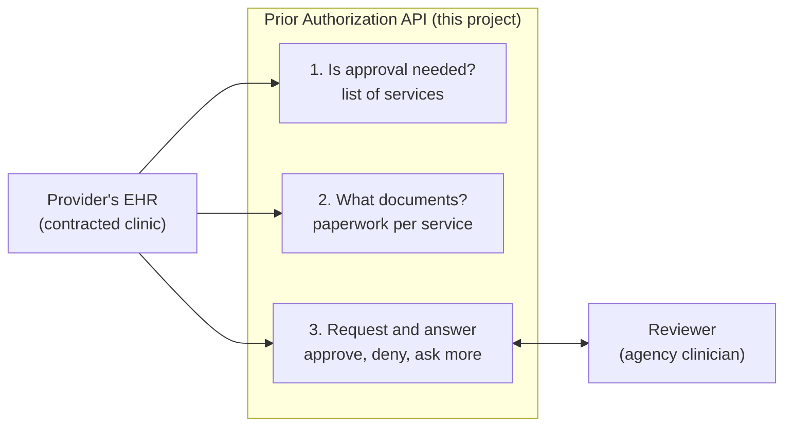

# 1. Overview: what this API is and why it exists

## The problem

When a contracted clinic wants to deliver a service that needs the plan's approval first, someone fills in a form, faxes or emails it, and waits. The federal rule CMS-0057-F says the plan must also let the clinic's software do this directly, system to system. That system-to-system door is the **Prior Authorization API**.

The agency is the plan (the payer), so the agency builds the server. The clinics' EHR systems are the callers.

## Where the requirement comes from

| Source | What it says |
|---|---|
| [CMS-0057-F](https://www.cms.gov/newsroom/fact-sheets/cms-interoperability-prior-authorization-final-rule-cms-0057-f) | Payers, including Medicaid managed care plans, must run a Prior Authorization API by January 1, 2027. Drugs are excluded. |
| [DHCS BHIN 26-008](https://www.dhcs.ca.gov/Documents/BHIN-26-008-Interoperability-Requirements-for-MHPs-and-DMC-ODS.pdf) | Applies the rule to county Mental Health Plans and DMC-ODS plans. Names no implementation guides; requires public API documentation, testing and monitoring. |
| CMS letter GL-2024-02 | A FHIR-only API is acceptable; the older X12 278 transaction need not be used. |

## The three questions the API answers

1. **Does this service need approval?** The EHR asks about a service code, together with its code system (HCPCS or CPT), and the API says yes or no.
2. **What paperwork is required?** For a service that does need approval, the API lists the documentation the plan wants.
3. **Here is my request; what is your answer?** Each request is for one service. The API replies with one of three answers: approved (with an end date), denied (with a specific reason), or more information needed.

The API does not change who decides. A clinician at the agency reviews every request. The API carries the request in and the decision out.

## How the standards map to the three questions

| Question | Standard | In this project today |
|---|---|---|
| 1. Is approval needed? | Da Vinci CRD (Coverage Requirements Discovery) | CDS Hooks services at `/cds-services`, and a simple list at `GET /requirements` |
| 2. What documents? | Da Vinci DTR (Documentation Templates and Rules) | A questionnaire per service at `POST /fhir/Questionnaire/$questionnaire-package` |
| 3. Request and answer | Da Vinci PAS (Prior Authorization Support) | `POST /fhir/Claim/$submit`, `POST /fhir/Claim/$inquire` and `GET /fhir/ClaimResponse/{id}` |

All three sit on **FHIR R4**, the healthcare data format. In C# the [Firely SDK](https://github.com/FirelyTeam/firely-net-sdk) reads and writes it.

The rule requires the three functions and FHIR. The Da Vinci guides are the recommended way to deliver them. A proposed rule (CMS-0062-P) would make them mandatory later.

## Vocabulary you will meet

| FHIR or standard term | Plain meaning |
|---|---|
| `Bundle` | An envelope holding several records sent together. |
| `Claim` with `use = preauthorization` | The authorization request. FHIR reuses its claim record for this. |
| `ClaimResponse` | The plan's answer. |
| `OperationOutcome` | An error message. Every error from `/fhir` comes back as one, including sign-in errors. |
| Code system | Which code list a service code comes from: HCPCS (`http://www.cms.gov/Medicare/Coding/HCPCSReleaseCodeSets`) or CPT (`http://www.ama-assn.org/go/cpt`). A code only matches the plan's list when its system matches too. |
| `CapabilityStatement` | The server's description of what it supports, at `/fhir/metadata`. |
| Review action code `A1` | Approved ("certified in total"). |
| Review action code `A3` | Denied ("not certified"). |
| Review action code `A4` | Pended, waiting for a person. |
| Review action code `NA` | No action required; the service needs no approval. |

The project's own business terms are in [GLOSSARY.md](../GLOSSARY.md).

[6. Asking first: CRD and DTR](06-crd-and-dtr.md) explains how the three standards work together.

Next: [2. How it works](02-how-it-works.md)
