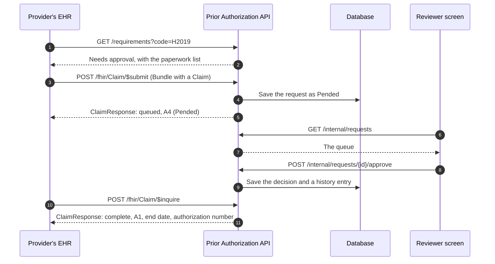
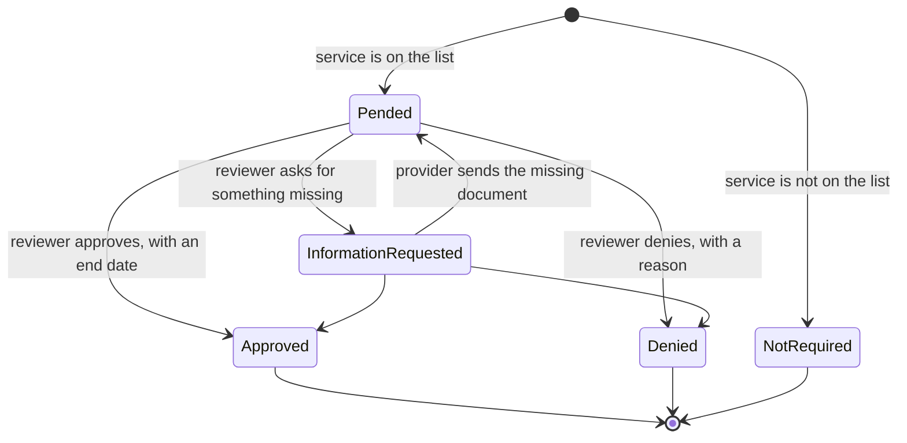
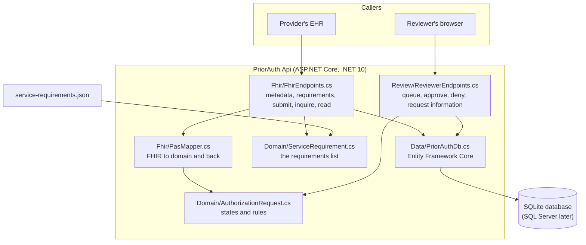
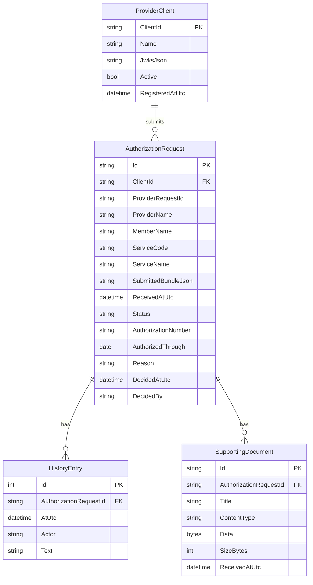
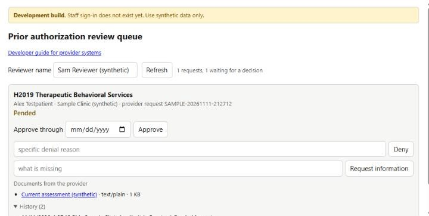

# 2. How it works

## One request from start to finish

The first answer to a submitted request is "pended", because a person has to decide. The provider learns the decision by asking again (`$inquire`) or reading the response by its id.

## The states a request can be in

Rules the code enforces, in [AuthorizationRequest.cs](../src/PriorAuth.Api/Domain/AuthorizationRequest.cs):

- Only an open request (Pended or InformationRequested) can be acted on. A decided request cannot be changed.
- An approval must have an end date that is today or later.
- A denial must state a specific reason. This is a requirement of the rule.
- An information request must say what is missing.
- Every action must name the reviewer, and every action is written to the request's history.
- A provider that sends the same request identifier twice gets the same answer, not a second request.
- A provider system must sign in, and can only see requests it sent itself.
- Supporting documents must be PDF, JPEG, PNG, TIFF or plain text, at most 5 MB each and 10 per submission, and sent inline. Anything else is refused.
- When a reviewer has asked for information, the provider answers by sending the request again with the missing documents. The request goes back to Pended. Resending at any other time changes nothing.

## The parts of the system

| File | What it is for |
|---|---|
| [Program.cs](../src/PriorAuth.Api/Program.cs) | Wires everything together and starts the app. |
| [Domain/AuthorizationRequest.cs](../src/PriorAuth.Api/Domain/AuthorizationRequest.cs) | The request, its states and the rules. No FHIR and no database code here. |
| [Domain/ServiceRequirement.cs](../src/PriorAuth.Api/Domain/ServiceRequirement.cs) | A service that needs approval and its paperwork, plus the catalog that looks them up. |
| [Fhir/PasMapper.cs](../src/PriorAuth.Api/Fhir/PasMapper.cs) | Reads what we need from the incoming FHIR `Bundle`, and builds the `ClaimResponse`. |
| [Fhir/FhirJson.cs](../src/PriorAuth.Api/Fhir/FhirJson.cs) | Reads and writes FHIR JSON with the Firely SDK, and builds FHIR error responses. |
| [Fhir/FhirEndpoints.cs](../src/PriorAuth.Api/Fhir/FhirEndpoints.cs) | The URLs a provider's EHR calls. |
| [Review/ReviewerEndpoints.cs](../src/PriorAuth.Api/Review/ReviewerEndpoints.cs) | The URLs the reviewer screen calls. |
| [Data/PriorAuthDb.cs](../src/PriorAuth.Api/Data/PriorAuthDb.cs) | The database mapping. |
| [Auth/](../src/PriorAuth.Api/Auth) | Sign-in for provider systems. See [5. Sign-in](05-sign-in.md). |
| [service-requirements.json](../src/PriorAuth.Api/service-requirements.json) | The list of services needing approval. Placeholder content today. |
| [wwwroot/index.html](../src/PriorAuth.Api/wwwroot/index.html) | The reviewer screen. |

## What is stored

The provider's original FHIR `Bundle` is kept exactly as received in `SubmittedBundleJson`, so the response can echo the right references and so there is a record of what was sent.

## The reviewer screen

The screen is a single page served by the same app. It lists requests newest first, shows the documents the provider sent as download links, and lets a reviewer approve, deny or ask for information. When a rule is broken, for example a denial with no reason, the server refuses and the page shows the server's message.

## How FHIR maps to the domain

| Incoming FHIR | Stored as |
|---|---|
| `Claim.identifier[0].value` | `ProviderRequestId` |
| The signed-in client's registered name | `ProviderName` |
| `Patient.name[0]` in the same Bundle | `MemberName` |
| `Claim.item[0].productOrService.coding[0].code` | `ServiceCode` |
| Each `DocumentReference.content.attachment` in the Bundle | A supporting document |

| Domain state | `ClaimResponse.outcome` | Review action code | Other fields |
|---|---|---|---|
| Pended | `queued` | A4 | |
| InformationRequested | `queued` | A4 | A `CommunicationRequest` in the Bundle, referenced from `communicationRequest`, says what is missing |
| Approved | `complete` | A1 | `preAuthRef`, `preAuthPeriod.end` |
| Denied | `complete` | A3 | `disposition` carries the reason |
| NotRequired | `complete` | NA | |

I compared this mapping by reading against the published PAS 2.0.1 definitions on 2026-11-11. Confirmed: where the review action extension sits, its sub-extension names, the response Bundle type and timestamp, the required `insurer`, and the use of `CommunicationRequest` for information requests.

Still not done ([issue #8](https://github.com/tngo0508/prior-auth-api/issues/8)):

- No automated validator or Inferno run has been made against the output.
- The code system URL used for review action codes (`https://codesystem.x12.org/005010/306`) is unconfirmed; the guide binds to an X12 value set.
- The `CommunicationRequest` is minimal and not checked against the PAS profile for it.
- PAS also requires `identifier` and `timestamp` on the request Bundle; this service does not enforce them yet.
- PAS has item-level extensions (authorized dates, trace numbers) that are not produced.

Previous: [1. Overview](01-overview.md) · Next: [3. Running and testing](03-running-and-testing.md)
