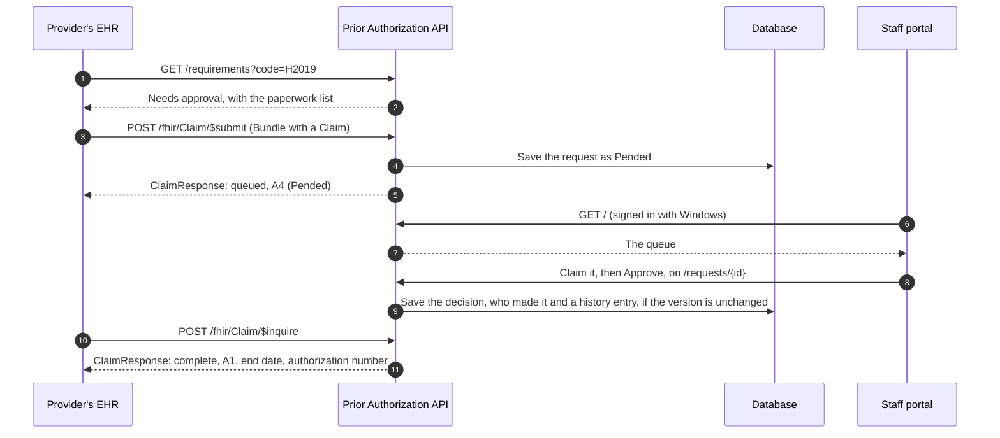
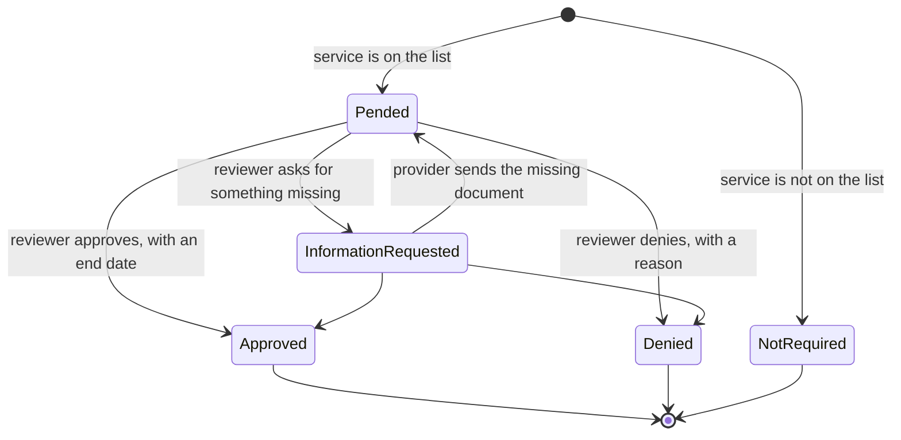
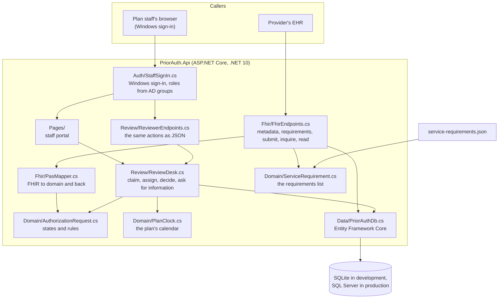
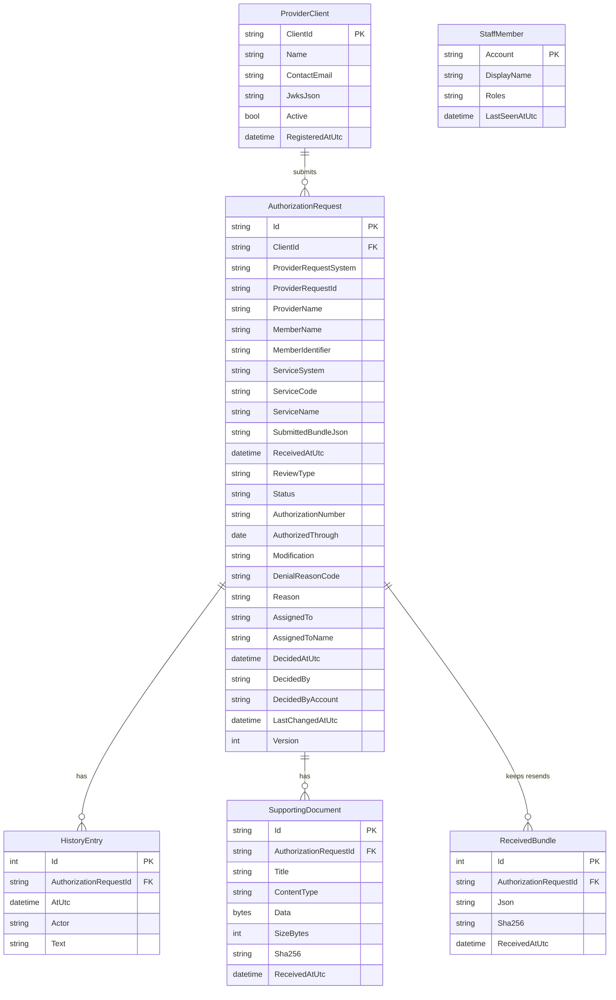
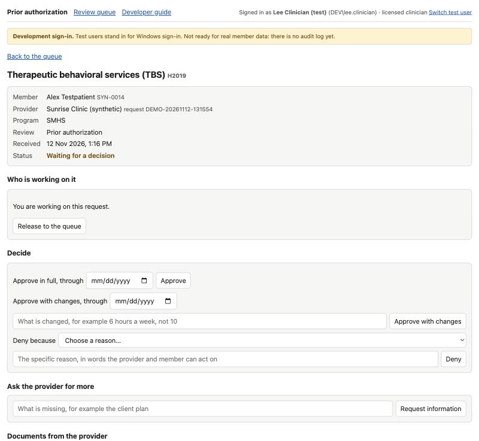

# 2. How it works

## One request from start to finish

The first answer to a submitted request is "pended", because a person has to decide. The provider learns the decision by asking again (`$inquire`) or reading the response by its id.

`$inquire` matches on the system and value of `Claim.identifier`, among the caller's own requests. When nothing matches, the answer is 200 with an empty Bundle, not 404. An inquiry with no Claim, or a Claim with no identifier, is refused with 400.

Reading `GET /fhir/ClaimResponse/{id}` returns an `ETag` (`W/"version"`) and a `Last-Modified` header. A poller that sends the ETag back in `If-None-Match` gets 304 Not Modified, with no body, until something changes.

## The states a request can be in

Rules the code enforces, in [AuthorizationRequest.cs](../src/PriorAuth.Api/Domain/AuthorizationRequest.cs):

- Only an open request (Pended or InformationRequested) can be acted on. A decided request cannot be changed.
- An approval must have an end date that is today or later. "Today" is the plan's local date (see [Dates](#dates-are-the-plans-local-dates) below), not the UTC date.
- A denial must state a specific reason. This is a requirement of the rule. A denial carries no authorization number or end date.
- An information request must say what is missing.
- Every action must name the reviewer, and every action is written to the request's history.
- Two reviewers cannot both decide the same request. Each request carries a version number that goes up on every change; a decision based on an out-of-date copy is refused with 409 and the reviewer is asked to reload.
- A provider system must sign in, and can only see requests it sent itself.
- Supporting documents must be PDF, JPEG, PNG, TIFF or plain text, at most 5 MB each and 10 per submission, and sent inline. Anything else is refused.

### Sending the same request again

A request is known by three things together: the provider system that sent it, and the system and value of `Claim.identifier`. Two providers may use the same number without colliding.

- Sending the same identifier again with the same member and service is a resend. The provider gets the current answer, not a second request. Two copies sent at the same moment also get one request between them.
- Sending the same identifier for a different member or a different service is refused with 422. A provider must use a new identifier for a new request.
- Each resent Bundle that differs from what is already on file is kept for the record, with document contents removed. An identical resend (a plain retry or a poll) is not stored twice.
- When a reviewer has asked for information, the provider answers by sending the request again with the missing documents. Documents already on file (recognised by their SHA-256 fingerprint) are ignored, so a plain retry does not count as an answer. If at least one new document arrives, it is stored and the request goes back to Pended.
- Resending at any other time does not change the answer, and documents in it are not added to the request.
- The answer always describes the request as first received.

### What a request must contain

`$submit` refuses with 400 and an `OperationOutcome` saying why, unless all of these hold. The checks are in [PasMapper.cs](../src/PriorAuth.Api/Fhir/PasMapper.cs).

| Part | Rule |
|---|---|
| The Bundle | Type `collection`, sent directly or wrapped in a `Parameters` resource under `resource`. |
| The `Claim` | Exactly one, and it is the first entry of the Bundle. |
| `Claim.status` and `Claim.use` | `active` and `preauthorization`. |
| `modifierExtension` | None, on the Claim or its line. Updating or cancelling a request is not supported, so such a request is refused rather than misread. |
| `Claim.identifier` | Present, with a value that has no leading or trailing spaces. System and value at most 200 characters each. |
| `Claim.insurer` | Present. |
| `Claim.item` | Exactly one line: one service per request. A Claim with several lines is refused rather than having the later lines dropped. |
| The service code | `item.productOrService.coding` carries a code and states its code system, for example HCPCS (`http://www.cms.gov/Medicare/Coding/HCPCSReleaseCodeSets`) or CPT (`http://www.ama-assn.org/go/cpt`). The first coding found on the plan's list is the service; if none is on the list, the first coding is used and the answer is "not required". |
| `Claim.patient` | Points to a `Patient` included in the Bundle, by `fullUrl` or by type and id. |

A `$submit` body larger than about 71 MB (ten 5 MB documents after base64 encoding, plus room for the rest) is refused with 413 and an `OperationOutcome`.

### Dates are the plan's local dates

Dates a person reads (whether an approval ends on or after today, the date in an authorization number, the issue date on the response line, the date on a CRD answer) use the calendar in the plan's time zone. The setting is `Plan:TimeZone`, default `America/Los_Angeles`, read in [PlanClock.cs](../src/PriorAuth.Api/Domain/PlanClock.cs). An approval at 5 p.m. Pacific is not treated as made tomorrow. Exact moments are still stored in UTC.

## The parts of the system

| File | What it is for |
|---|---|
| [Program.cs](../src/PriorAuth.Api/Program.cs) | Wires everything together and starts the app. Also the server's outer rules: FHIR JSON only, security headers, no caching, errors as `OperationOutcome`, `/health`. |
| [Domain/AuthorizationRequest.cs](../src/PriorAuth.Api/Domain/AuthorizationRequest.cs) | The request, its states and the rules. No FHIR and no database code here. |
| [Domain/ServiceRequirement.cs](../src/PriorAuth.Api/Domain/ServiceRequirement.cs) | A service that needs approval and its paperwork, plus the catalog that looks them up by code system and code. The catalog checks the file when the service starts. |
| [Domain/PlanClock.cs](../src/PriorAuth.Api/Domain/PlanClock.cs) | The plan's calendar: today's date in the plan's time zone. |
| [Fhir/PasMapper.cs](../src/PriorAuth.Api/Fhir/PasMapper.cs) | Reads what we need from the incoming FHIR `Bundle`, and builds the `ClaimResponse`. |
| [Fhir/FhirJson.cs](../src/PriorAuth.Api/Fhir/FhirJson.cs) | Reads and writes FHIR JSON with the Firely SDK, and builds FHIR error responses. |
| [Fhir/FhirEndpoints.cs](../src/PriorAuth.Api/Fhir/FhirEndpoints.cs) | The URLs a provider's EHR calls. |
| [Review/ReviewDesk.cs](../src/PriorAuth.Api/Review/ReviewDesk.cs) | Every action staff take on a request (claim, assign, decide, ask for information), shared by the portal pages and the internal endpoints. |
| [Review/ReviewerEndpoints.cs](../src/PriorAuth.Api/Review/ReviewerEndpoints.cs) | The same actions as JSON under `/internal`. |
| [Data/PriorAuthDb.cs](../src/PriorAuth.Api/Data/PriorAuthDb.cs) | The database mapping. |
| [Data/DatabaseHealthCheck.cs](../src/PriorAuth.Api/Data/DatabaseHealthCheck.cs) | The database check behind `GET /health`. |
| [Auth/](../src/PriorAuth.Api/Auth) | Sign-in for provider systems (see [5. Sign-in](05-sign-in.md)), and staff sign-in in [StaffSignIn.cs](../src/PriorAuth.Api/Auth/StaffSignIn.cs). |
| [service-requirements.json](../src/PriorAuth.Api/service-requirements.json) | The plan's service list: each service's code, code system, modifiers, review rule and questionnaire, plus the shared questionnaires. See [9. The service list](09-service-list.md). A broken entry (a malformed code, the same code and modifiers twice, a reviewed service without a questionnaire, a question id used twice, two answer options with the same code) stops the service at start-up with a message naming the problem. |
| [Pages/](../src/PriorAuth.Api/Pages) | The staff portal (Razor Pages): the review queue, a request with its decision forms, and provider systems. |

## What is stored

The provider's original FHIR `Bundle` is kept in `SubmittedBundleJson`, so the response can echo the right references and so there is a record of what was sent. Document contents are taken out of it first, because each document is stored once, on its own, in `SupportingDocument`. Later Bundles sent under the same identifier are kept the same way in `ReceivedBundle`.

The three columns `ClientId`, `ProviderRequestSystem` and `ProviderRequestId` together are unique: that is what makes a resend find the first request. On SQL Server they are compared exactly, so `REQ-1` and `req-1` are different requests. `Version` goes up on every change and is what the database checks to refuse a decision made on an out-of-date copy.

`StaffMember` is not linked to requests. It lists the people who have signed in to the portal, so a coordinator can assign a request to someone; the app does not read the Active Directory user list. `AssignedTo` and `DecidedByAccount` hold sign-in accounts such as `COUNTY\jdoe`.

## The staff portal

The portal is a set of Razor Pages served by the same app. Plan staff sign in with Windows; what they see depends on their roles, which come from Active Directory groups.

- **The queue** (`/`) lists requests waiting for a decision or for the provider, oldest first, with who is working on each. Other tabs show the person's own requests, decided ones, and all.
- **A request** (`/requests/{id}`) shows what was asked, the documents the provider sent as download links, and the history. Anyone who works the queue can claim it; a coordinator can assign it to someone or release it. A licensed clinician or physician can approve, approve with changes, or deny with a reason from the plan's list; only a physician decides a concurrent review. Anyone who works the queue can ask the provider for more information.
- **Provider systems** (`/providers`) is for admins: register a provider's system with its public keys, or switch one off. In Development it can also make a test key in the browser ([Sign-in for provider systems](05-sign-in.md#a-test-key-in-development-only)).

When a rule is broken, for example a coordinator trying to approve, the page shows why and nothing changes. If someone else changed the request after the page was loaded, the action is refused and the page shows the request as it is now.

## How FHIR maps to the domain

| Incoming FHIR | Stored as |
|---|---|
| `Claim.identifier[0].system` and `.value` | `ProviderRequestSystem` and `ProviderRequestId` |
| The signed-in client's registered name | `ProviderName` |
| `Patient.name[0]` of the Patient that `Claim.patient` points to | `MemberName` |
| That Patient's first `identifier`, as `system\|value` | `MemberIdentifier` |
| The chosen `Claim.item[0].productOrService.coding` (see the table above) | `ServiceSystem` and `ServiceCode` |
| Each `DocumentReference.content.attachment` in the Bundle | A supporting document |
| Each `QuestionnaireResponse` in the Bundle | A plain text document pairing each question with its answer, flagging required questions left unanswered |

A resend is the same request when the service system and code match and the member matches: by `MemberIdentifier` when both copies have one, otherwise by name.

| Domain state | `ClaimResponse.outcome` | Review action code | Other fields |
|---|---|---|---|
| Pended | `queued` | A4 | |
| InformationRequested | `queued` | A4 | A `CommunicationRequest` in the Bundle, referenced from `communicationRequest`, says what is missing |
| Approved | `complete` | A1 | `preAuthRef`, `preAuthPeriod.end`, the authorization number in the review action, `itemPreAuthIssueDate` on the line |
| Denied | `complete` | A3 | `disposition` carries the reason; `itemPreAuthIssueDate` on the line |
| NotRequired | `complete` | NA | |

Every `ClaimResponse` also carries `meta.versionId` (the request's version), `meta.lastUpdated` and `created` (both the time the answer took its current form, so reading it twice gives the same values), and the line number the provider gave its service line. The response Bundle echoes the Patient, insurer and requesting provider entries from the provider's Bundle, so every reference in the answer resolves inside it.

I compared this mapping by reading against the published PAS 2.0.1 definitions on 2026-11-11. Confirmed: where the review action extension sits, its sub-extension names, the response Bundle type and timestamp, the required `insurer`, and the use of `CommunicationRequest` for information requests. During the [November 2026 audit](07-audit-2026-11.md) response Bundles were also checked once with the Firely validator against the PAS 2.0.1 package.

Still not done ([issue #8](https://github.com/tngo0508/prior-auth-api/issues/8)):

- No validator runs as part of the build, and no Inferno run has been made against the output.
- The code system URL used for review action codes (`https://codesystem.x12.org/005010/306`) is unconfirmed; the guide binds to an X12 value set.
- The `CommunicationRequest` is minimal and not checked against the PAS profile for it.
- PAS also requires `identifier` and `timestamp` on the request Bundle; this service does not enforce them yet.
- The Patient, Coverage and other resources in a request are not checked against the US Core or PAS profiles.
- Some PAS item-level extensions (authorized dates, trace numbers) are not produced.
- Partial approval and coded denial reasons are not supported: the whole line is approved or denied, and the reason is free text.

Previous: [1. Overview](01-overview.md) · Next: [3. Running and testing](03-running-and-testing.md)
