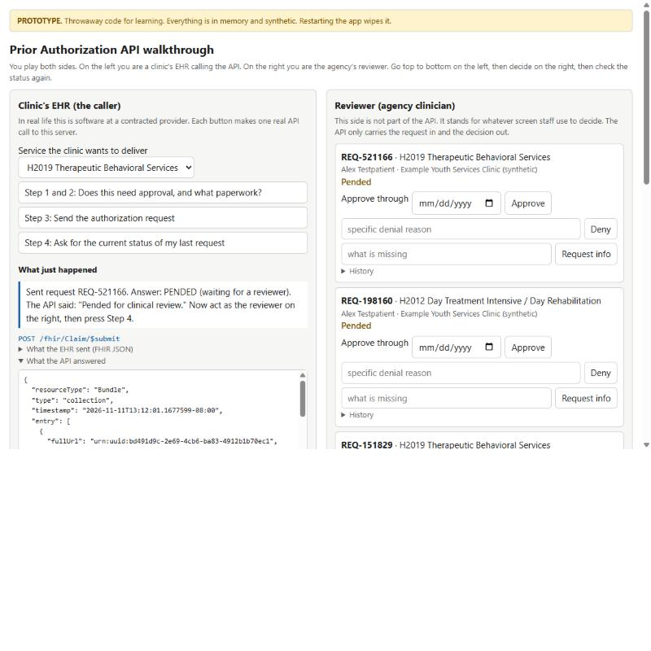

# 3. Running and testing

You need the .NET 10 SDK. Use synthetic data only; agency staff sign-in does not exist yet.

## Two things you can run

| | Learning prototype | The service |
|---|---|---|
| Folder | `prototype/PriorAuth.Prototype` | `src/PriorAuth.Api` |
| Purpose | Understand the flow by playing both sides | The code that will become the real API |
| Storage | Memory, wiped on restart | SQLite file `priorauth.db` |
| Address | http://localhost:5019 | http://localhost:5020 |

### The learning prototype

```bash
dotnet run --project prototype/PriorAuth.Prototype --no-launch-profile --urls http://localhost:5019
```

Open http://localhost:5019. On the left you are the clinic's EHR; on the right you are the reviewer. Press the steps top to bottom, decide on the right, then check the status again.



### The service

```bash
dotnet run --project src/PriorAuth.Api --no-launch-profile --urls http://localhost:5020
```

Open http://localhost:5020 for the reviewer queue. Provider systems must sign in, so to send requests as a provider would, run the sample client in a second terminal:

```bash
dotnet run --project samples/PriorAuth.SampleClient -- http://localhost:5020
```

It registers, asks whether an order needs authorization, signs in, downloads the questionnaire, submits a request with answers and a document, and waits for you to decide it in the queue. [5. Sign-in](05-sign-in.md) and [6. CRD and DTR](06-crd-and-dtr.md) explain what it is doing. [requests.http](../src/PriorAuth.Api/requests.http) holds the calls that need no token.

To start with an empty database, stop the app and delete `src/PriorAuth.Api/priorauth.db`. Do this too after pulling changes that alter the data model: the local SQLite file is created once and is not upgraded.

The developer guide for provider systems is served at http://localhost:5020/developers.html.

### Running on SQL Server

SQLite is for local development. On SQL Server the app applies its migrations at start-up:

```bash
dotnet run --project src/PriorAuth.Api --no-launch-profile --urls http://localhost:5020 --Database:Provider=SqlServer --ConnectionStrings:PriorAuth="Server=(localdb)\MSSQLLocalDB;Database=PriorAuthDev;Integrated Security=true"
```

After changing the data model, add a migration:

```bash
dotnet ef migrations add NameOfTheChange --project src/PriorAuth.Api -o Data/Migrations
```

## The endpoints

### For providers

| Method and path | Purpose | Answers with |
|---|---|---|
| `GET /fhir/metadata` | What the server supports | `CapabilityStatement` |
| `GET /fhir/.well-known/smart-configuration` | Where and how to sign in | JSON |
| `POST /auth/token` | Sign in with a signed assertion | Access token, valid 300 seconds |
| `GET /cds-services` | CRD: lists the CDS Hooks services | JSON |
| `POST /cds-services/prior-auth-order-sign` | CRD: is approval needed for these draft orders? | Orders marked with coverage information |
| `POST /fhir/Questionnaire/$questionnaire-package` | DTR: the questionnaire for a service | `Parameters` holding package Bundles |
| `GET /fhir/Questionnaire/{id}` | DTR: one questionnaire | `Questionnaire` |
| `GET /requirements` | All services needing approval | JSON list |
| `GET /requirements?code=H2019` | One service and its paperwork | JSON list, empty if no approval is needed |
| `POST /fhir/Claim/$submit` | Send an authorization request | `Bundle` holding a `ClaimResponse` |
| `POST /fhir/Claim/$inquire` | Ask for the current state | `Bundle` holding a `ClaimResponse`, or 404 |
| `GET /fhir/ClaimResponse/{id}` | Read one answer by id | `ClaimResponse`, or 404 |

Submit, inquire and read need an access token; without one the answer is 401, and with a token lacking the right scope it is 403. Other errors come back as a FHIR `OperationOutcome` with status 400 or 404.

### For agency staff

These only answer callers on the server's own machine until staff sign-in exists.

| Method and path | Body |
|---|---|
| `GET /internal/requests` | |
| `POST /internal/requests/{id}/approve` | `{ "through": "2027-02-28", "reviewer": "name" }` |
| `POST /internal/requests/{id}/deny` | `{ "reason": "text", "reviewer": "name" }` |
| `POST /internal/requests/{id}/request-information` | `{ "missing": "text", "reviewer": "name" }` |
| `GET /internal/requests/{id}/documents/{documentId}` | Downloads one supporting document |
| `GET /internal/clients` | |
| `POST /internal/clients` | `{ "name": "provider name", "jwks": { "keys": [ ... ] } }` |
| `POST /internal/clients/{clientId}/deactivate` | |

A broken rule returns status 422 with the reason in `detail`.

## Automated tests

```bash
dotnet test
```

The tests start the real application against a temporary database and call it over HTTP, signing in the way a provider system would. There are 65, in [PriorAuthApiTests.cs](../tests/PriorAuth.Api.Tests/PriorAuthApiTests.cs), [SignInTests.cs](../tests/PriorAuth.Api.Tests/SignInTests.cs), [SupportingDocumentTests.cs](../tests/PriorAuth.Api.Tests/SupportingDocumentTests.cs) and [CrdAndDtrTests.cs](../tests/PriorAuth.Api.Tests/CrdAndDtrTests.cs). Each test name is a sentence stating a behaviour:

| Area | Behaviours covered |
|---|---|
| Requirements list | States the documentation for a listed service; is empty for an unlisted one. |
| Submitting | A request is pended; an unlisted service is answered "not required"; a resend does not create a second request; invalid FHIR and non-preauthorization claims are rejected. |
| Decisions | An approval returns an end date and number; an approval cannot end in the past; a denial needs a reason; a denial returns its reason; an information request keeps the request open; a decided request cannot be decided again; every step is in the history. |
| Reading | A response can be read by id; an unknown request returns 404; the capability statement advertises submit and inquire. |
| Getting a token | A valid assertion gets a 300-second token; refused when signed with another key, from an unregistered or deactivated client, addressed to another server, expired, too long-lived, reused, or asking for no supported scope. |
| Registering | A key set containing a private key is refused. |
| CRD | Discovery lists the services; a listed service is marked as needing authorization with its questionnaire; an unlisted one needs none and no coverage is claimed; prefetched coverage is used; no coverage gives a warning card; unsigned, wrong-audience, wrong-hook and non-JSON calls are refused. |
| DTR | A package starts with the questionnaire and includes a draft response; it can be chosen from the order; nothing applicable gives 404; questionnaires need a token and the right scope; answers sent with a request reach the reviewer as readable text. |
| Supporting documents | A document reaches the reviewer unchanged and is served as a download; unaccepted types, oversized files and links are refused; sending the missing document answers an information request; resending at other times changes nothing. |
| Using the API | No token gives 401; the descriptive endpoints need none; a token without the read scope cannot read; a provider cannot see another provider's request; two providers can use the same request number; the registered name is recorded, not the claimed one. |

By default the tests use a temporary SQLite file. To run the same tests on SQL Server, using the real migrations, set an environment variable first. Each test class gets its own database and drops it afterwards.

```powershell
$env:PRIORAUTH_TEST_SQLSERVER = 'Server=(localdb)\MSSQLLocalDB;Integrated Security=true'; dotnet test
```

Previous: [2. How it works](02-how-it-works.md) · Next: [4. Status and open questions](04-status-and-open-questions.md)
