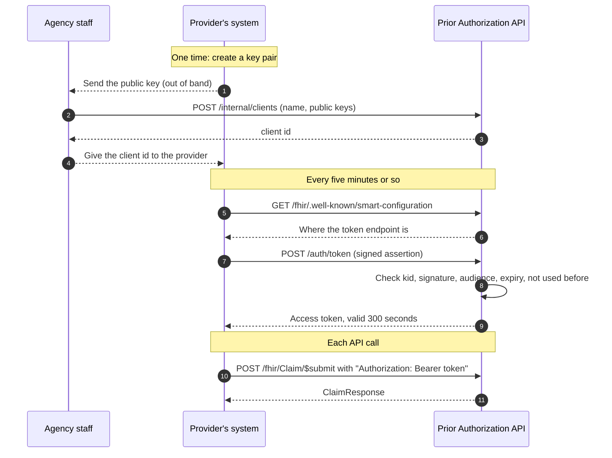

# 5. Sign-in for provider systems

## The idea in plain terms

No person logs in. A provider's *system* proves who it is with a key pair:

- The provider keeps a **private key** secret.
- The agency stores the matching **public key** when it registers the provider.
- To sign in, the provider's system signs a short note saying "I am client X, this is for your token address, valid for two minutes". Only the holder of the private key can produce that signature, and anyone with the public key can check it.
- If it checks out, the server hands back an **access token** that works for five minutes. The provider sends that token with each API call.

No password or shared secret ever travels over the network or sits in the agency's database. This scheme is called **SMART Backend Services**, and it is the standard the rule points to for system-to-system access.

## The flow



## What the server checks before giving a token

| Check | What it stops |
|---|---|
| The client id is registered and active | Unknown or switched-off systems |
| `iss` and `sub` are both the client id | An assertion that does not say plainly who it is for |
| The header's `kid` matches exactly one registered key, and only that key is tried | Guessing among keys, or a key set with ambiguous ids |
| The signature matches that key | Someone pretending to be the provider |
| Signing algorithm is RS384 or ES384, and fits the key's type | Weak or unsigned tokens |
| The header's `typ`, if present, is `JWT` | Another kind of token being passed off as an assertion |
| The assertion names this server's token address as its audience | An assertion made for another payer being reused here |
| The assertion has not expired, and expires within five minutes | Old or long-lived assertions |
| `iat`, if present, is not in the future | Assertions made in advance |
| The assertion's unique id (`jti`) has not been seen before, checked under a lock | A captured assertion being replayed, even by two requests at once |

A check that depends on the client's registration fails with `401`, `"error": "invalid_client"` and the same message every time, so a caller cannot learn which client ids exist. The specific reason is written to the server log. A malformed request (not form encoded, wrong `grant_type` or `client_assertion_type`, no supported scope) gets `400` with the matching OAuth error.

Token responses, successful or not, carry `Cache-Control: no-store`.

## What a token allows

| Scope (SMART v1) | SMART v2 equivalents | Allows |
|---|---|---|
| `system/Claim.write` | `system/Claim.c`, `system/Claim.cud` | Submit a request and inquire about it |
| `system/ClaimResponse.read` | `system/ClaimResponse.rs` | Read a response by its id |
| `system/Questionnaire.read` | `system/Questionnaire.rs`, `system/questionnaire.rs` (the DTR spelling) | Download questionnaires, report questionnaire errors |

Both spellings are accepted. Any v2 permission string works if it contains the letter the action needs (`c` for Claim, `r` for the other two), so `system/ClaimResponse.r` reads responses but `system/Claim.rs` cannot submit. The token response echoes the scopes as the client spelled them. Scopes with parameters (`?`) or wildcards are not offered.

A provider only ever sees its own requests. If Clinic B asks about Clinic A's request, the answer is the same as for a request that does not exist: an empty result from `$inquire`, 404 from reading by id. Two providers may use the same request number without colliding.

The provider name recorded on a request is the name the agency registered, not whatever the request itself claims.

## What needs no token

- `GET /fhir/metadata` and `GET /fhir/.well-known/smart-configuration`: they only describe the server.
- `GET /requirements`: the list of services needing approval is plan policy, not member data.
- `GET /health`: says only whether the service and its database are up.

## The discovery document

`/fhir/.well-known/smart-configuration` lists the token endpoint, `client_credentials` as the only grant, `private_key_jwt` with RS384 and ES384, the scopes above, and the capabilities `client-confidential-asymmetric`, `permission-v1` and `permission-v2`.

SMART requires every server to list an `authorization_endpoint` and `code_challenge_methods_supported`, even one that offers only Backend Services. So the document lists `/auth/authorize` and `S256`. There is no user sign-in: `/auth/authorize` answers every request with `400` and `"error": "unsupported_response_type"`.

## Registering a provider

Staff register a provider by posting its name and public keys:

```http
POST /internal/clients
Content-Type: application/json

{ "name": "Example Clinic", "jwks": { "keys": [ { "kty": "RSA", "kid": "...", "use": "sig", "alg": "RS384", "n": "...", "e": "AQAB" } ] } }
```

The answer (201) contains the `clientId` to give to the provider. Every key in the set must pass these rules, or the registration is refused with 422 and a message naming the key and the problem:

- RSA keys of at least 2048 bits (for RS384), or EC keys on curve P-384 (for ES384). Nothing else.
- Each key has its own non-empty `kid`.
- `use`, if given, is `sig`; `alg`, if given, matches the key type.
- No symmetric (`oct`) keys: a shared secret must never be sent.
- No private key material. If the set contains any, the server says so, because that key must then be treated as compromised.

The same rules are checked again each time a key is used, so a key registered before the rules existed cannot be used either.

Admins can do the same in the staff portal: **Provider systems** (`/providers`) has a form for the name, a contact email and the key set, and a **Switch off** button on each row. Ask the provider's developer for their key set, and check who sent it before registering: whoever holds the matching private key can send requests under that provider's name.

### A test key, in Development only

With the Development test sign-in, the form also offers **Generate a test key**. The browser makes an ES384 key pair (P-384) with the built-in Web Crypto API, puts the public part in the key set box, and offers the private part as a file to save (`<provider-name>-private-key.json`). The server never receives the private key, and nothing keeps a copy: if the page reloads before you save it, the key is gone, so the page warns before registering with an unsaved key. The button needs a secure page (http://localhost or https).

It is for trying the flow by hand, never for a real provider. A key made by the plan is a key the plan has seen; a real provider makes its own and sends only the public part.

`POST /internal/clients/{clientId}/deactivate` switches a client off. It can no longer get tokens, and a token it already holds is refused at once on every call, not only when it expires.

## Try it

With the service running, start the clinic demo and open http://localhost:5030:

```bash
dotnet run --project samples/PriorAuth.ClinicDemo
```

It creates a key pair, registers, signs in, checks the requirements, submits a request, and asks for the status until you decide it in the staff portal. The provider side is in [PlanConnection.cs](../samples/PriorAuth.ClinicDemo/PlanConnection.cs), the reference for a provider's developer. To register by hand instead, use **Generate a test key** on the Provider systems page (above).

## Limits to know about

- **Plan staff sign in separately.** This page is about provider systems. Plan staff sign in to the portal with Windows Integrated Authentication, and get their roles from Active Directory groups; in Development they pick a test user instead. Registering a provider system needs the admin role. The rules are in [Running and testing](03-running-and-testing.md#for-plan-staff).
- **One server instance only.** The key that signs access tokens is created at start-up, so a restart signs every provider out, and the "already used" memory for assertions lives in that one process. Before running more than one instance, move the key to a secret store and the memory to shared storage ([issue #14](https://github.com/tngo0508/prior-auth-api/issues/14)).
- **No key rotation by URL.** Keys are registered as a fixed set; a JWKS URL is not accepted ([issue #31](https://github.com/tngo0508/prior-auth-api/issues/31)).
- **The public address must be configured.** Outside Development the server will not start without `Auth:PublicBaseUrl` set to an absolute https URL. Token audiences and the addresses in the discovery document come from it, never from the caller's `Host` header.
- **TLS is required in any real deployment.** A bearer token is as good as a password to anyone who can read the traffic.

Where the code is:

| File | Purpose |
|---|---|
| [Auth/TokenEndpoint.cs](../src/PriorAuth.Api/Auth/TokenEndpoint.cs) | The discovery document, `/auth/authorize` and the token endpoint |
| [Auth/ClientAssertions.cs](../src/PriorAuth.Api/Auth/ClientAssertions.cs) | Every check in the table above, and the public address setting |
| [Auth/ClientKeys.cs](../src/PriorAuth.Api/Auth/ClientKeys.cs) | Which keys may be registered and used |
| [Auth/AccessTokens.cs](../src/PriorAuth.Api/Auth/AccessTokens.cs) | Scope names (v1 and v2) and access token creation |
| [Auth/AuthSetup.cs](../src/PriorAuth.Api/Auth/AuthSetup.cs) | Token validation on API calls, refusing deactivated clients, sign-in errors as `OperationOutcome`, scope policies, the local-only guard |
| [Auth/ClientRegistrationEndpoints.cs](../src/PriorAuth.Api/Auth/ClientRegistrationEndpoints.cs) | Registering and deactivating provider systems |
| [Auth/ProviderClient.cs](../src/PriorAuth.Api/Auth/ProviderClient.cs) | The stored record of a registered system |

Previous: [4. Status and open questions](04-status-and-open-questions.md) · Next: [6. Asking first: CRD and DTR](06-crd-and-dtr.md)
