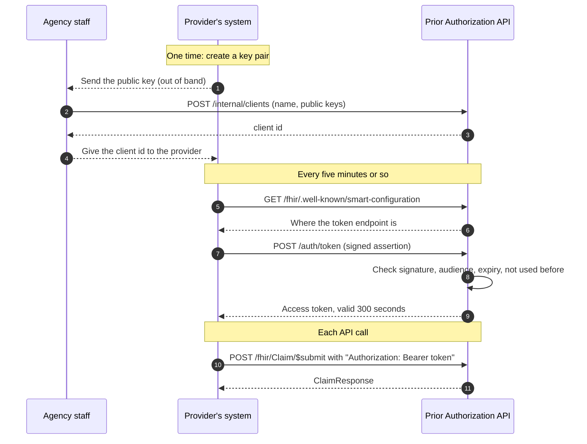

# 5. Sign-in for provider systems

## The idea in plain terms

No person logs in. A provider's *system* proves who it is with a key pair:

- The provider keeps a **private key** secret.
- The agency stores the matching **public key** when it registers the provider.
- To sign in, the provider's system signs a short note saying "I am client X, this is for your token address, valid for two minutes". Only the holder of the private key can produce that signature, and anyone with the public key can check it.
- If it checks out, the server hands back an **access token** that works for five minutes. The provider sends that token with each API call.

No password or shared secret ever travels over the network or sits in the agency's database. This scheme is called **SMART Backend Services**, and it is the standard the rule points to for system-to-system access.

## The flow



## What the server checks before giving a token

| Check | What it stops |
|---|---|
| The client id is registered and active | Unknown or switched-off systems |
| The signature matches a registered public key | Someone pretending to be the provider |
| The assertion names this server's token address as its audience | An assertion made for another payer being reused here |
| The assertion has not expired, and expires within five minutes | Old or long-lived assertions |
| The assertion's unique id (`jti`) has not been seen before | A captured assertion being replayed |
| Signing algorithm is RS384 or ES384 | Weak or unsigned tokens |

Failures return `401` with `"error": "invalid_client"`.

## What a token allows

| Scope | Allows |
|---|---|
| `system/Claim.write` | Submit a request and inquire about it |
| `system/ClaimResponse.read` | Read a response by its id |

A provider only ever sees its own requests. If Clinic B asks about Clinic A's request, the answer is "not found", the same as for a request that does not exist. Two providers may use the same request number without colliding.

The provider name recorded on a request is the name the agency registered, not whatever the request itself claims.

## What needs no token

- `GET /fhir/metadata` and `GET /fhir/.well-known/smart-configuration`: they only describe the server.
- `GET /requirements`: the list of services needing approval is plan policy, not member data.

## Registering a provider

Staff register a provider by posting its name and public keys:

```http
POST /internal/clients
Content-Type: application/json

{ "name": "Example Clinic", "jwks": { "keys": [ { "kty": "RSA", "kid": "...", "use": "sig", "alg": "RS384", "n": "...", "e": "AQAB" } ] } }
```

The answer contains the `clientId` to give to the provider. If the key set contains private key material, the server refuses it and says so, because that key must then be treated as compromised.

`POST /internal/clients/{clientId}/deactivate` switches a client off. It can no longer get tokens, and a token it already holds stops working for new submissions.

## Try it

With the service running:

```bash
dotnet run --project samples/PriorAuth.SampleClient -- http://localhost:5020
```

[The sample client](../samples/PriorAuth.SampleClient/Program.cs) creates a key pair, registers, signs in, checks the requirements, submits a request, waits for you to decide it in the reviewer queue, and asks for the status. It is about 120 lines and is the reference for a provider's developer.

## Limits to know about

- **Agency staff do not sign in yet.** Until they do, everything under `/internal` (the reviewer queue and client registration) only answers callers on the server's own machine. This is a stopgap, tracked in [issue #2](https://github.com/tngo0508/prior-auth-api/issues/2).
- **One server instance only.** The key that signs access tokens is created at start-up, and the "already used" memory for assertions lives in that one process. Before running more than one instance, move both to shared storage.
- **Scopes use the SMART v1 names.** SMART v2 spells them differently (`system/Claim.c`, and so on). Which one providers' systems expect is not yet confirmed.
- **TLS is required in any real deployment.** A bearer token is as good as a password to anyone who can read the traffic.

Where the code is:

| File | Purpose |
|---|---|
| [Auth/TokenEndpoint.cs](../src/PriorAuth.Api/Auth/TokenEndpoint.cs) | The token endpoint and every check in the table above |
| [Auth/AccessTokens.cs](../src/PriorAuth.Api/Auth/AccessTokens.cs) | Scope names and access token creation |
| [Auth/AuthSetup.cs](../src/PriorAuth.Api/Auth/AuthSetup.cs) | Token validation on API calls, scope policies, the local-only guard |
| [Auth/ClientRegistrationEndpoints.cs](../src/PriorAuth.Api/Auth/ClientRegistrationEndpoints.cs) | Registering and deactivating provider systems |
| [Auth/ProviderClient.cs](../src/PriorAuth.Api/Auth/ProviderClient.cs) | The stored record of a registered system |

Previous: [4. Status and open questions](04-status-and-open-questions.md)
