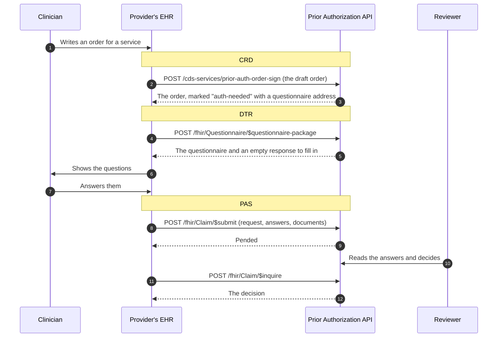

# 6. Asking first: CRD and DTR

The first two of the three questions in the [overview](01-overview.md) have a standard form. This page explains them and how they connect to the request itself.

| Question | Standard | What happens |
|---|---|---|
| 1. Is approval needed? | CRD, Coverage Requirements Discovery | While a clinician writes an order, the EHR asks the plan. The plan marks the order with the answer. |
| 2. What do you need to know? | DTR, Documentation Templates and Rules | The EHR downloads the plan's questionnaire for that service. A person completes it. |
| 3. Request and answer | PAS, Prior Authorization Support | The EHR submits the request with the answers attached. A reviewer decides. |

The simple list at `GET /requirements` still exists. CRD and DTR are the same information in the form EHR systems are built to consume.

## The three standards as one conversation



## CRD: is approval needed?

CRD is built on **CDS Hooks**, a general way for an EHR to ask an outside service for advice at a set moment in the clinician's work. The moment is called a hook.

| Address | Purpose |
|---|---|
| `GET /cds-services` | Lists the services this server offers. Needs no sign-in. |
| `POST /cds-services/prior-auth-order-sign` | Called when an order is signed (`order-sign` hook). |
| `POST /cds-services/prior-auth-order-select` | Called while an order is being written (`order-select` hook). |

The EHR sends the draft orders. For each `ServiceRequest`, the server sends the order back with a **coverage information** extension added. The EHR applies it as a "system action", which means it updates the order without asking the clinician to click anything.

What the extension says:

| Part | Service is on the plan's list | Service is not on the list |
|---|---|---|
| `covered` | `covered` | `conditional` |
| `pa-needed` | `auth-needed` | `no-auth` |
| `doc-needed` | `clinical` | left out |
| `questionnaire` | Address of the service's questionnaire | left out |
| `coverage` | The member's coverage the answer applies to | same |
| `date` | Today | same |
| `coverage-assertion-id` | A unique id for this answer | same |

Two things to understand about these answers:

- **This service does not check eligibility.** It does not know whether the member is enrolled today. For a service on the list it says `covered` because the service is a plan benefit. For anything else it says `conditional` and never claims coverage it has not checked.
- **A coverage must be named.** The extension has to say which coverage it speaks for. The server takes it from the order, or from coverage the EHR sent ahead of time ("prefetch"). If neither is there, the server changes nothing and returns a warning card explaining why.

### How a CDS Hooks call is authenticated

CDS Hooks does not use the access token from [sign-in](05-sign-in.md). Every call carries its own short statement signed with the provider system's private key, made for the exact address being called. The server checks it against the same registered public key, with the same rules: right audience, not expired, at most five minutes long, used once.

## DTR: what do you need to know?

Each service on the list has a questionnaire. Its questions come from `Questions` in [service-requirements.json](../src/PriorAuth.Api/service-requirements.json), so clinical policy staff can change them without touching code. The questions there today are placeholders.

| Address | Purpose |
|---|---|
| `POST /fhir/Questionnaire/$questionnaire-package` | Returns the questionnaire package. Name the questionnaire, or send the order and let the plan choose. |
| `GET /fhir/Questionnaire/{id}` | Reads one questionnaire, for example `prior-auth-h2019`. |

Both need an access token with the `system/Questionnaire.read` scope.

A package is a `Bundle` whose first entry is the `Questionnaire`, followed by a draft `QuestionnaireResponse` for the EHR to fill in. The answer to `$questionnaire-package` is a `Parameters` resource with one `PackageBundle` per questionnaire.

Question types supported: yes/no, short text, long text, date, and a choice from a fixed list.

## The answers reach the reviewer

The EHR includes the completed `QuestionnaireResponse` in the request it submits. The server turns it into a plain text document, pairing each question with its answer, and stores it with the request. The reviewer sees it in the queue next to any other documents:

```text
Questionnaire answers: Therapeutic Behavioral Services

Date of the most recent assessment: 2026-10-30
Target behaviours TBS will address: Synthetic example: elopement and aggression at school.
Is the member at risk of a higher level of placement without TBS?: Yes
Requested hours per week: 11 to 20
```

The original `QuestionnaireResponse` is also kept, inside the stored request.

## Try it

With the service running:

```bash
dotnet run --project samples/PriorAuth.SampleClient -- http://localhost:5020
```

[The sample client](../samples/PriorAuth.SampleClient/Program.cs) asks about an order (CRD), downloads the questionnaire it is pointed to (DTR), and submits a request with answers and a document (PAS). Then open the reviewer queue to see what arrived.

## What this does not do yet

These are real gaps against the two guides, tracked in [issue #16](https://github.com/tngo0508/prior-auth-api/issues/16):

- **No automatic filling of answers.** DTR's main benefit is that the EHR can fill answers from the chart using rules (CQL) supplied by the plan. These questionnaires carry no such rules, so a person types every answer. The DTR profile permits this, but the time saving is not delivered.
- **Only two hooks.** `order-sign` and `order-select` are offered. The guide also names `order-dispatch`, `appointment-book`, `encounter-start` and `encounter-discharge`.
- **Only `ServiceRequest` orders are examined.** Device, medication and other order types are ignored.
- **No eligibility check**, as described above.
- **No configuration options** in the discovery response, which the guide expects for services that return cards.
- **The answer is not remembered.** The `coverage-assertion-id` is not stored or matched to the later request.
- **Required answers are not enforced.** A request is accepted even if a required question is unanswered; the reviewer judges completeness.
- **The CDS Hooks request shape and token rules were written from knowledge of that specification**, not re-read during this work, because its site refused automated reading. The CRD and DTR definitions themselves were read from the published 2.0.1 files.
- **Scope names** use the SMART v1 spelling; the DTR guide lists v2 spellings.
- **Nothing here has been run against the Inferno test kits.**

Where the code is:

| File | Purpose |
|---|---|
| [Crd/CrdEndpoints.cs](../src/PriorAuth.Api/Crd/CrdEndpoints.cs) | CDS Hooks discovery and the two services |
| [Dtr/DtrEndpoints.cs](../src/PriorAuth.Api/Dtr/DtrEndpoints.cs) | The questionnaire package and read endpoints |
| [Dtr/QuestionnaireBuilder.cs](../src/PriorAuth.Api/Dtr/QuestionnaireBuilder.cs) | Builds a FHIR Questionnaire from a service's questions |
| [Auth/ClientAssertions.cs](../src/PriorAuth.Api/Auth/ClientAssertions.cs) | Checks a signed statement, for both sign-in and CDS Hooks |
| [Fhir/PasMapper.cs](../src/PriorAuth.Api/Fhir/PasMapper.cs) | Turns questionnaire answers into a document for the reviewer |

Previous: [5. Sign-in for provider systems](05-sign-in.md)
