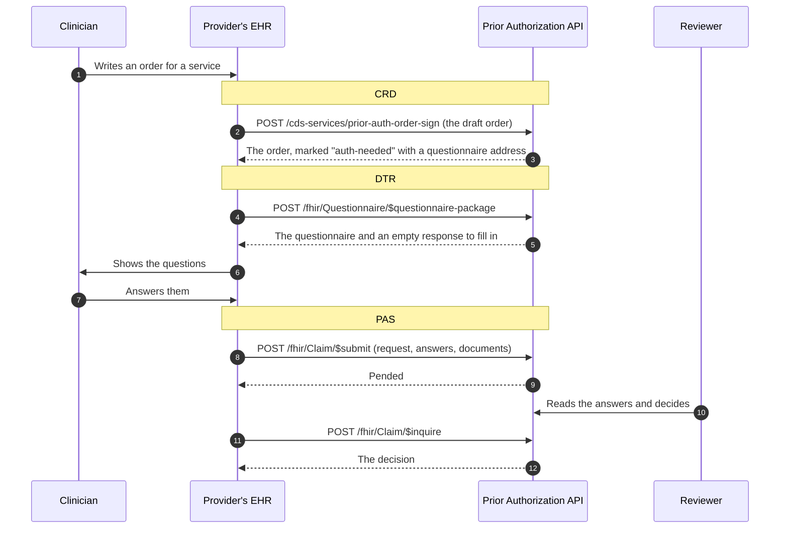

# 6. Asking first: CRD and DTR

The first two of the three questions in the [overview](01-overview.md) have a standard form. This page explains them and how they connect to the request itself.

| Question | Standard | What happens |
|---|---|---|
| 1. Is approval needed? | CRD, Coverage Requirements Discovery | While a clinician writes an order, the EHR asks the plan. The plan marks the order with the answer. |
| 2. What do you need to know? | DTR, Documentation Templates and Rules | The EHR downloads the plan's questionnaire for that service. A person completes it. |
| 3. Request and answer | PAS, Prior Authorization Support | The EHR submits the request with the answers attached. A reviewer decides. |

The simple list at `GET /requirements` still exists. CRD and DTR are the same information in the form EHR systems are built to consume.

## The three standards as one conversation



## CRD: is approval needed?

CRD is built on **CDS Hooks**, a general way for an EHR to ask an outside service for advice at a set moment in the clinician's work. The moment is called a hook.

| Address | Purpose |
|---|---|
| `GET /cds-services` | Lists the services this server offers. Needs no sign-in. |
| `POST /cds-services/prior-auth-order-sign` | Called when an order is signed (`order-sign` hook). |
| `POST /cds-services/prior-auth-order-select` | Called while an order is being written (`order-select` hook). |

The EHR sends the draft orders. For each `ServiceRequest`, the server sends the order back with a **coverage information** extension added. The EHR applies it as a "system action", which means it updates the order without asking the clinician to click anything.

The order's code must say which code system it comes from: HCPCS (`http://www.cms.gov/Medicare/Coding/HCPCSReleaseCodeSets`), CPT (`http://www.ama-assn.org/go/cpt`) or NUBC revenue codes (`https://www.nubc.org/CodeSystem/RevenueCodes`). A code only matches the plan's list when its system matches too. How codes and modifiers are matched, and why, is in [9. The service list](09-service-list.md).

What the extension says:

| Part | Prior authorization | Concurrent review | No prior authorization, or not on the list | Ambiguous or unrecognised code |
|---|---|---|---|---|
| `covered` | `conditional` | `conditional` | `conditional` | `conditional` |
| `pa-needed` | `auth-needed` | `no-auth` | `no-auth` | `conditional` |
| `doc-needed` | `clinical` (order-sign only) | left out | left out | left out |
| `doc-purpose` | `withpa`: the documentation goes with the prior authorization request (order-sign only) | left out | left out | left out |
| `questionnaire` | Address of the service's questionnaire (order-sign only) | left out | left out | left out |
| `reason` | left out | Notify the plan within 24 hours of admission through `$submit`, with the questionnaire's address | "may not require prior authorization" for a listed service; "not on the plan's list" otherwise | Which modifiers need review, or a request to check the code |
| `coverage`, `date`, `coverage-assertion-id` | The member's coverage, today in the plan's time zone, a unique id for this answer | same | same | same |

An order carries no billing modifiers. When the entries for a code differ only by modifier and lead to the same rule and questionnaire (day treatment intensive and day rehabilitation, both `H2012`), the answer is definite. When they lead to different rules (`H0019`: adult residential needs no authorization, the DMC-ODS residential levels do), the answer is `conditional`.

The two hooks differ. CRD calls `order-sign` a primary hook: every order gets an answer, including what documentation is needed. `order-select` is a secondary hook: it answers only the orders listed in `context.selections` (which it requires), and never says documentation is needed.

Things to understand about these answers:

- **This service does not check eligibility.** It does not know whether the member is enrolled in the plan's program today, so `covered` is always `conditional`. It never claims coverage it has not checked.
- **A coverage must be named.** The extension has to say which coverage it speaks for. The server takes it from the order, or from coverage the EHR sent ahead of time ("prefetch"). If neither is there, the server changes nothing and returns an information card explaining why.
- **An incomplete order is explained, not annotated.** The CRD order profile requires `authoredOn` and `requester`. An order missing either gets a card saying what to add.
- **Nothing new, no update.** If the order already carries the same answer for the same coverage, it is not sent back. An answer for a different coverage is kept; only the one for this coverage is replaced.
- **Cards say who they are from.** Each card names the plan as its `source.label` (setting `Plan:Name`) and carries the CRD `source.topic` `coverage-info`.
- **Only `ServiceRequest` orders are examined.** Other order types are skipped and the skip is logged on the server.

### Configuration options

Discovery offers one option per service, `coverage-info` (boolean, default on), as CRD expects. An EHR can send `"extension": { "davinci-crd.configuration": { "coverage-info": false } }` to turn it off, and then gets no answer at all, because coverage information is all this service returns. Options it does not know are ignored.

### A call of the wrong shape

A body that is not JSON gets 400. JSON that is not a CDS Hooks request for this hook (wrong `hook`, no `hookInstance`, no `context.draftOrders`, `prefetch` or configuration of the wrong kind, `context.selections` missing on order-select) gets 422 with an `OperationOutcome` saying what is wrong.

### How a CDS Hooks call is authenticated

CDS Hooks does not use the access token from [sign-in](05-sign-in.md). Every call carries its own short statement signed with the provider system's private key, made for the exact address being called. The server checks it against the same registered public key, with the same rules: a `kid` naming exactly one registered key, right audience, not expired, at most five minutes long, used once. Unlike sign-in, it needs no `sub`. A call without one, or with one that fails, gets 401.

## DTR: what do you need to know?

Each reviewed service names a questionnaire, and several services can share one (TBS and TFC share `dtr-mhp-youth`). The questionnaires are defined in the `Questionnaires` section of [service-requirements.json](../src/PriorAuth.Api/service-requirements.json), so clinical policy staff can change them without touching code. All of them are drafts written from the DHCS notices: they are published with FHIR status `draft` and say so in their text until the plan's clinical lead signs them off. Each lists the documents to send in its `description`.

| Address | Purpose |
|---|---|
| `POST /fhir/Questionnaire/$questionnaire-package` | Returns the questionnaire package. Name the questionnaire, or send the order and let the plan choose. |
| `GET /fhir/Questionnaire/{id}` | Reads one questionnaire, for example `dtr-mhp-youth`. |
| `POST /fhir/Questionnaire/$log-questionnaire-errors` | A DTR app reports a problem it had with one of the plan's questionnaires. |
| `GET` or `POST /fhir/ValueSet/$expand` | Required by the DTR payer capability statement. The plan publishes no value sets (answer options are listed inside each questionnaire), so the answer is always 404. |

All need an access token with the `system/Questionnaire.read` scope, or a SMART v2 spelling of it such as `system/questionnaire.rs`, the one the DTR guide uses.

The server's capability statement at `/fhir/metadata` declares the PAS, DTR and CRD 2.0.1 guides, the `Questionnaire` resource with the DTR questionnaire profile, its read interaction and both operations, and `ValueSet/$expand`.

### The package

The request is a `Parameters` resource. It may hold:

| Parameter | Meaning |
|---|---|
| `questionnaire` | A questionnaire's full canonical address, for example `https://host/fhir/Questionnaire/dtr-mhp-youth`, optionally with `\|1` for the version. The whole address must match this server's; a bare id or another server's address is not found. |
| `order` | A `ServiceRequest`. The plan picks the questionnaire from its code, matched on code system and code. |
| `coverage` | The member's `Coverage`. DTR expects one. |

The answer is a `Parameters` resource with one `PackageBundle` per questionnaire, listed by service code whatever order the parameters came in. Each is a `Bundle` whose first entry is the `Questionnaire`, followed by a draft `QuestionnaireResponse` for the EHR to fill in. The draft follows the DTR QuestionnaireResponse profile: it names the patient (from the order, or else the coverage's beneficiary), when it was made, the Coverage and orders it is for (`qr-context` extensions), its purpose (`intendedUse` `withpa`), and one empty item per question. Context the caller did not send is left out, not invented.

Anything that could not be used is reported, not silently dropped: a questionnaire not found, a version not available, an order for a service not on the list, a non-`ServiceRequest` order, a missing coverage. These come back as warnings in an `OperationOutcome` under the parameter named `operationOutcome`, the name the DTR output profile fixes. When nothing applies at all, the answer is 404 with an `OperationOutcome` holding the same warnings.

### Reporting questionnaire errors

`$log-questionnaire-errors` takes a `Parameters` resource with `Questionnaire` (the canonical) and `OperationOutcome` (the problems). Each issue is written to the server log for the staff who maintain the questionnaires, and the reply is a short informational `OperationOutcome`. A report missing either parameter gets 400. The DTR guide forbids member information in these reports.

Question types supported: yes/no, short text, long text, date, and a choice from a fixed list.

## The answers reach the reviewer

The EHR includes the completed `QuestionnaireResponse` in the request it submits. The server turns it into a plain text document, pairing each question with its answer, and stores it with the request. The reviewer sees it in the queue next to any other documents:

```text
Questionnaire answers: Therapeutic Behavioral Services

Date of the most recent assessment: 2026-10-30
Target behaviours TBS will address: Synthetic example: elopement and aggression at school.
Is the member at risk of a higher level of placement without TBS?: Yes
Requested hours per week: 11 to 20
```

For a choice question the reviewer sees the plan's own wording of the option, not the text the EHR sent with it; an answer that is not one of the plan's options is marked as such. The document starts with a note when the answers are not marked completed, when they answer a questionnaire that is not the plan's, or when required questions were left unanswered, naming those questions.

The original `QuestionnaireResponse` is also kept, inside the stored request.

## Try it

With the service running, start the clinic demo and open http://localhost:5030:

```bash
dotnet run --project samples/PriorAuth.ClinicDemo
```

It asks about an order (CRD), downloads the questionnaire it is pointed to (DTR), and submits a request with answers and a document (PAS); the calls are in [PlanConnection.cs](../samples/PriorAuth.ClinicDemo/PlanConnection.cs). Then open the reviewer queue to see what arrived.

## What this does not do yet

These are real gaps against the two guides, tracked in [issue #16](https://github.com/tngo0508/prior-auth-api/issues/16):

- **No automatic filling of answers.** DTR's main benefit is that the EHR can fill answers from the chart using rules (CQL) supplied by the plan. These questionnaires carry no such rules, so a person types every answer. The DTR profile permits this, but the time saving is not delivered.
- **Only two hooks.** `order-sign` and `order-select` are offered. The guide also names `order-dispatch`, `appointment-book`, `encounter-start` and `encounter-discharge`.
- **Only `ServiceRequest` orders are examined.** Device, medication and other order types are skipped (and logged).
- **No eligibility check**, as described above. A well-formed code that is not on the plan's list is answered `no-auth`, which is correct for services DHCS exempts. A code the plan cannot recognise is answered `conditional` ([issue #23](https://github.com/tngo0508/prior-auth-api/issues/23)). The plan's full list of covered codes would let the service tell an exempt service from one that is not a benefit at all.
- **One configuration option only.** `coverage-info` can be turned off; there are no finer options.
- **The answer is not remembered.** The `coverage-assertion-id` is not stored or matched to the later request.
- **Required answers are not enforced.** A request is accepted even if a required question is unanswered. The reviewer's copy names the unanswered required questions, and the reviewer judges completeness.
- **No value sets.** `ValueSet/$expand` exists only to say there are none.
- **The CDS Hooks JWT must be issued by the registered client id.** A CDS client that uses its own issuer is not yet accepted ([issue #32](https://github.com/tngo0508/prior-auth-api/issues/32)).
- **The CDS Hooks request shape and token rules were written from knowledge of that specification**, not re-read during this work, because its site refused automated reading. The CRD and DTR definitions themselves were read from the published 2.0.1 files.
- **Nothing here has been run against the Inferno test kits.**

Where the code is:

| File | Purpose |
|---|---|
| [Crd/CrdEndpoints.cs](../src/PriorAuth.Api/Crd/CrdEndpoints.cs) | CDS Hooks discovery and the two services |
| [Crd/CdsHookRequest.cs](../src/PriorAuth.Api/Crd/CdsHookRequest.cs) | Reads and checks the shape of a hook call |
| [Dtr/DtrEndpoints.cs](../src/PriorAuth.Api/Dtr/DtrEndpoints.cs) | The questionnaire package, read, error report and `$expand` endpoints |
| [Dtr/PackageRequest.cs](../src/PriorAuth.Api/Dtr/PackageRequest.cs) | Reads a package request into questionnaires and warnings |
| [Dtr/QuestionnaireBuilder.cs](../src/PriorAuth.Api/Dtr/QuestionnaireBuilder.cs) | Builds a FHIR Questionnaire and its draft response from a service's questions |
| [Auth/ClientAssertions.cs](../src/PriorAuth.Api/Auth/ClientAssertions.cs) | Checks a signed statement, for both sign-in and CDS Hooks |
| [Fhir/PasMapper.cs](../src/PriorAuth.Api/Fhir/PasMapper.cs) | Turns questionnaire answers into a document for the reviewer |

Previous: [5. Sign-in for provider systems](05-sign-in.md) · Next: [7. November 2026 audit](07-audit-2026-11.md)
