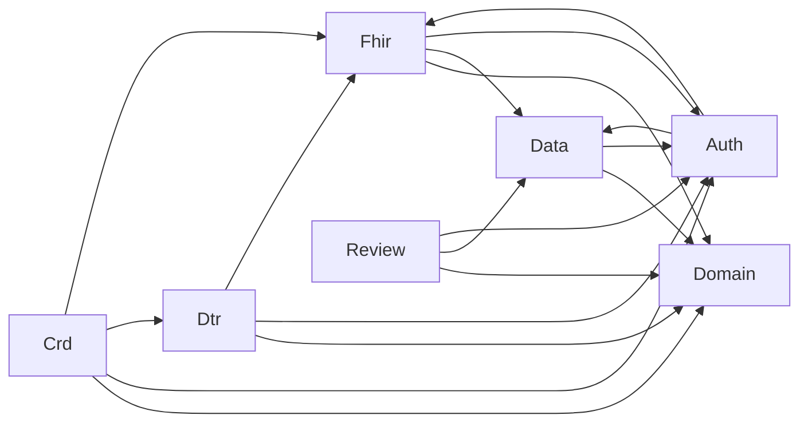
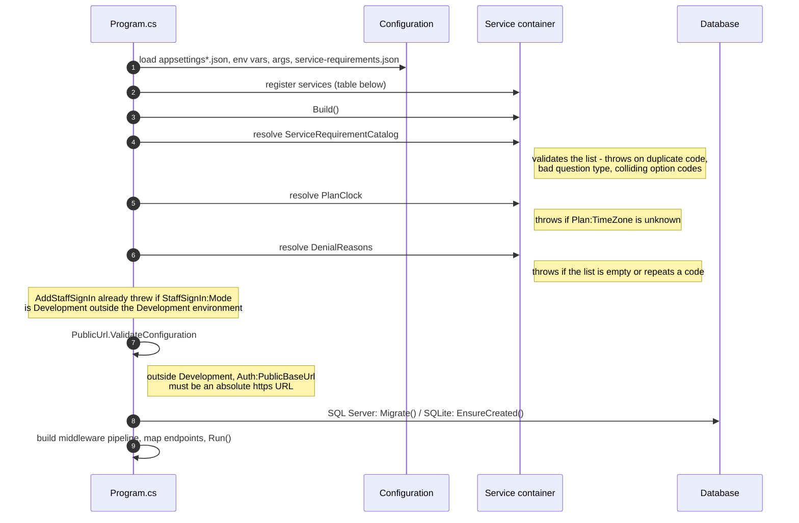
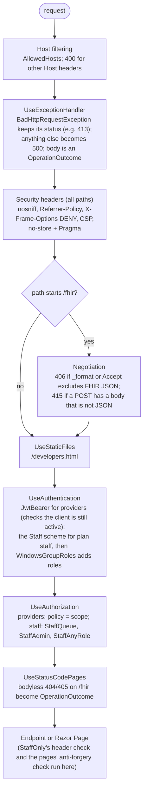
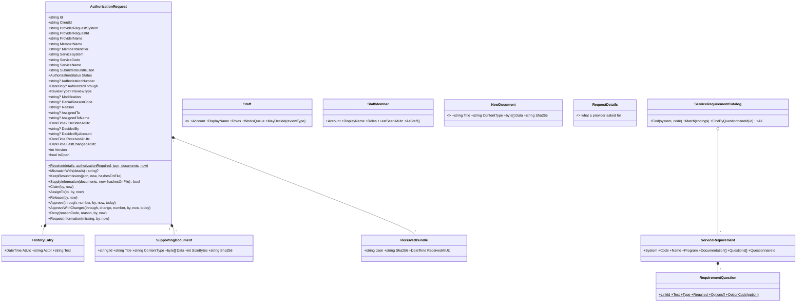
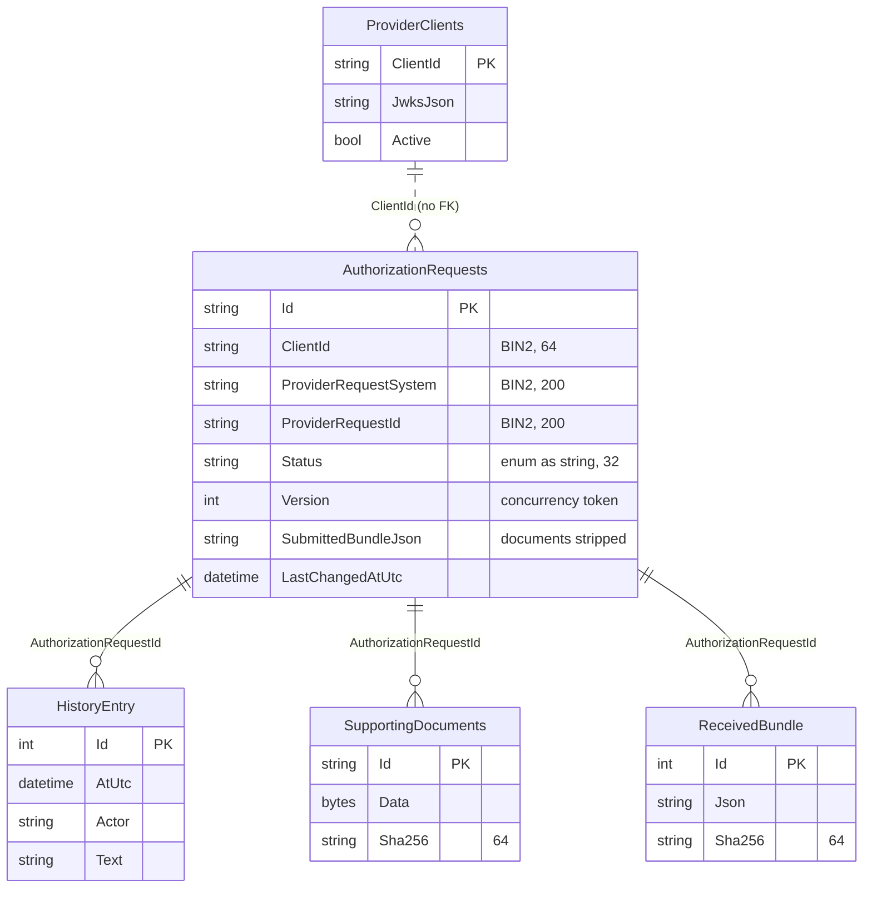
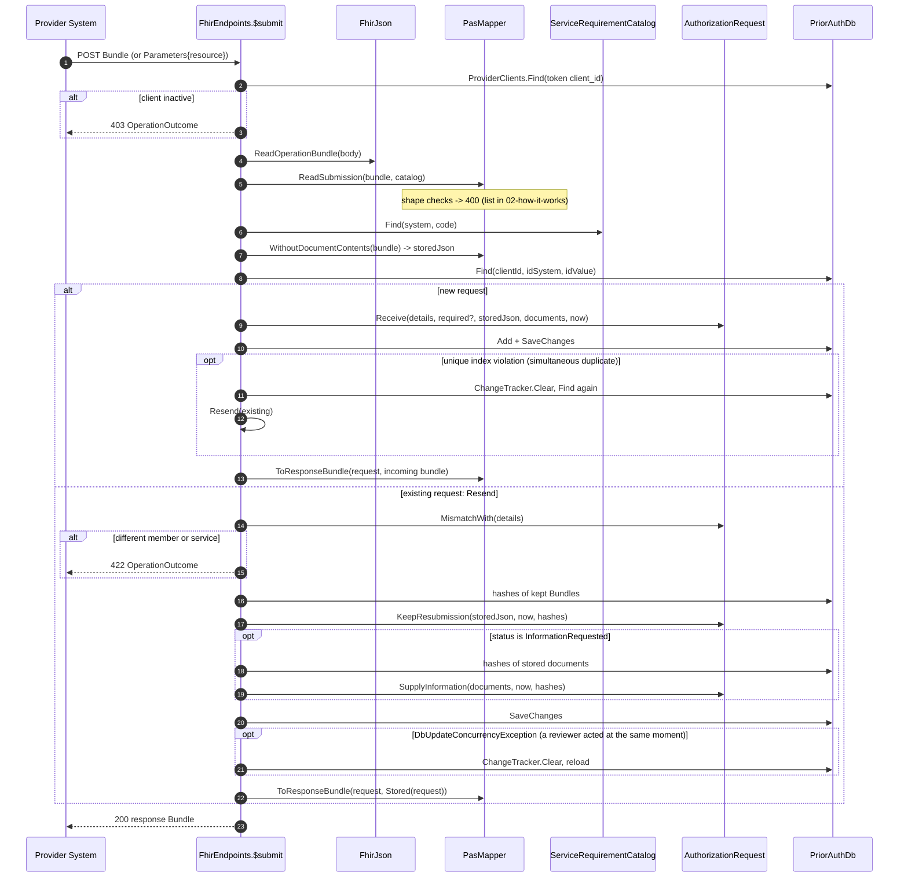
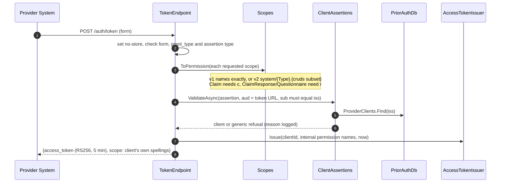
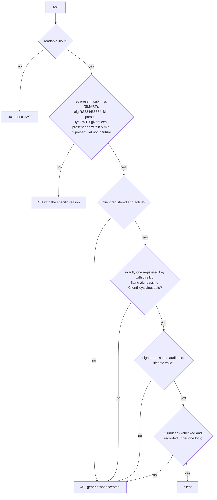
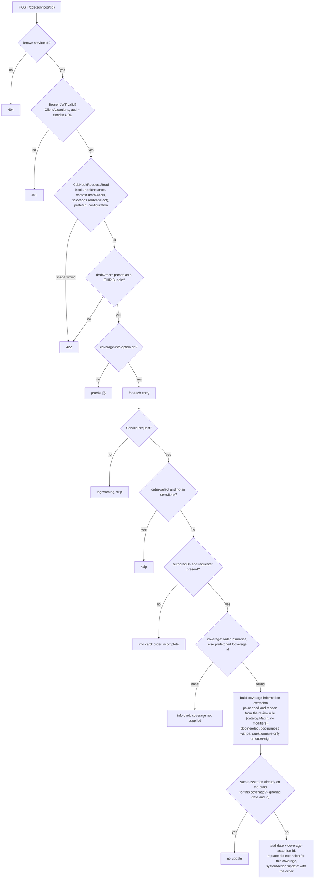

# 8. Codebase guide for developers

This guide is for the developer who will change this code. It walks the service from process start to database row and names the class and method behind each step. It also covers the rules you must not break and the recipes for common changes.

Read the [architecture overview](architecture.md) first for the system-level picture, and [How it works](02-how-it-works.md) for the business rules in plain language. This guide does not repeat them; it shows where they live in code.

**Contents**

1. [Mental model](#1-mental-model)
2. [Project and folder map](#2-project-and-folder-map)
3. [Start-up](#3-start-up)
4. [The HTTP pipeline](#4-the-http-pipeline)
5. [Endpoint map](#5-endpoint-map)
6. [Domain model](#6-domain-model)
7. [Persistence](#7-persistence)
8. [PAS: submit, inquire, read](#8-pas-submit-inquire-read)
9. [Reviewer endpoints](#9-reviewer-endpoints)
10. [Sign-in internals](#10-sign-in-internals)
11. [CRD internals](#11-crd-internals)
12. [DTR internals](#12-dtr-internals)
13. [Cross-cutting conventions](#13-cross-cutting-conventions)
14. [Configuration reference](#14-configuration-reference)
15. [Tests](#15-tests)
16. [Recipes](#16-recipes)
17. [Traps and known limits](#17-traps-and-known-limits)

---

## 1. Mental model

The service is one ASP.NET Core process with minimal-API endpoints grouped by standard (PAS, CRD, DTR, sign-in, reviewer). Every endpoint follows the same three-step shape:

```text
endpoint handler (Fhir/, Crd/, Dtr/, Review/, Auth/)
  1. read and check the incoming message      -> 400 / 422 with an explanation
  2. call the domain to apply business rules   -> Domain/AuthorizationRequest
  3. save with EF Core, map back to FHIR       -> Data/PriorAuthDb, Fhir/PasMapper
```

Four ideas carry most of the design:

| Idea | Where | Why it matters to you |
|---|---|---|
| **Business rules live only in `AuthorizationRequest`** | [Domain/AuthorizationRequest.cs](../src/PriorAuth.Api/Domain/AuthorizationRequest.cs) | Setters are private. A state change is a method call that checks its rule and writes history. Never change state from an endpoint. |
| **The service list is configuration, checked at start-up** | [Domain/ServiceRequirement.cs](../src/PriorAuth.Api/Domain/ServiceRequirement.cs), [service-requirements.json](../src/PriorAuth.Api/service-requirements.json) | CRD, DTR, `/requirements` and PAS all answer from one `ServiceRequirementCatalog`. A bad file stops the process before it takes traffic. |
| **FHIR stays at the edge** | [Fhir/PasMapper.cs](../src/PriorAuth.Api/Fhir/PasMapper.cs), [Dtr/QuestionnaireBuilder.cs](../src/PriorAuth.Api/Dtr/QuestionnaireBuilder.cs) | The domain holds plain strings and dates. The Firely SDK types appear only in the mappers and endpoints (the catalog's `Match` takes `Coding`s as its one exception). |
| **Time and addresses are injected, never read ad hoc** | [Domain/PlanClock.cs](../src/PriorAuth.Api/Domain/PlanClock.cs), `PublicUrl` in [Auth/ClientAssertions.cs](../src/PriorAuth.Api/Auth/ClientAssertions.cs) | Use `PlanClock.Today` for the plan's date and `PublicUrl.Base` for this server's address. `DateTime.Today` and `Request.Host` give wrong answers in production. |

## 2. Project and folder map

```text
prior-auth-api/
├── src/PriorAuth.Api/                 the service (the only deployable)
│   ├── Program.cs                     start-up, DI, middleware pipeline, endpoint mapping
│   ├── appsettings*.json              settings (section 14)
│   ├── service-requirements.json      services needing PA, their documents and questions
│   ├── Domain/
│   │   ├── AuthorizationRequest.cs    aggregate root + HistoryEntry, SupportingDocument, ReceivedBundle, NewDocument
│   │   ├── ServiceRequirement.cs      ServiceRequirement, RequirementQuestion, ServiceRequirementCatalog, CodeSystems
│   │   ├── Staff.cs                   StaffRole, Staff (who may work the queue and decide what)
│   │   ├── StaffMember.cs             people who have signed in to the portal, for assigning
│   │   └── PlanClock.cs               the plan's calendar (time zone aware "today" and local times)
│   ├── Fhir/
│   │   ├── FhirEndpoints.cs           /fhir/metadata, /requirements, $submit, $inquire, ClaimResponse read, CapabilityStatement
│   │   ├── PasMapper.cs               PAS Bundle -> Submission; AuthorizationRequest -> ClaimResponse / response Bundle
│   │   ├── FhirJson.cs                Firely JSON read/write, OperationOutcome errors
│   │   └── FhirMediaTypes.cs          what counts as FHIR JSON in Accept / Content-Type / _format
│   ├── Crd/
│   │   ├── CrdEndpoints.cs            CDS Hooks discovery + order-sign / order-select (CrdResponder inside)
│   │   └── CdsHookRequest.cs          reads and shape-checks a hook call body
│   ├── Dtr/
│   │   ├── DtrEndpoints.cs            Questionnaire read, $questionnaire-package, $log-questionnaire-errors, ValueSet/$expand
│   │   ├── PackageRequest.cs          reads $questionnaire-package input Parameters
│   │   └── QuestionnaireBuilder.cs    ServiceRequirement -> Questionnaire, package Bundle, draft QuestionnaireResponse
│   ├── Review/
│   │   ├── ReviewDesk.cs              every staff action on a request; DenialReasons from configuration
│   │   └── ReviewerEndpoints.cs       /internal/requests: queue JSON, document download, the ReviewDesk actions
│   ├── Pages/                         the staff portal (Razor Pages)
│   │   ├── Index.cshtml               the review queue
│   │   ├── Requests/Detail.cshtml     one request: facts, claim and assign, decision forms, documents, history
│   │   ├── Providers/Index.cshtml     register and switch off provider systems (admin)
│   │   ├── NoAccess.cshtml            signed in without the role a page needs
│   │   ├── SignIn/DevSignIn.cshtml    Development only: pick a test user
│   │   └── Shared/_Layout.cshtml      header, navigation, banner, styles
│   ├── Auth/
│   │   ├── AuthSetup.cs               JwtBearer + one policy per scope; StaffOnly for /internal
│   │   ├── StaffSignIn.cs             staff sign-in: Windows (Negotiate) or the Development test users; AD groups to roles
│   │   ├── TokenEndpoint.cs           /auth/token, /auth/authorize, smart-configuration
│   │   ├── ClientAssertions.cs        validates client-signed JWTs (token endpoint and CDS Hooks); PublicUrl
│   │   ├── ClientKeys.cs              which JWKs may be registered and used
│   │   ├── AccessTokens.cs            Scopes (v1/v2 mapping) and AccessTokenIssuer
│   │   ├── ClientRegistrationEndpoints.cs  /internal/clients
│   │   └── ProviderClient.cs          registered provider system entity
│   ├── Data/
│   │   ├── PriorAuthDb.cs             EF Core model, provider choice, collation, concurrency, UTC converter
│   │   ├── DesignTimeDbFactory.cs     lets `dotnet ef` build the SQL Server model without connecting
│   │   ├── DatabaseHealthCheck.cs     /health
│   │   └── Migrations/                SQL Server migrations (Initial, AuditFixes, ReviewType, StaffSignIn)
│   └── wwwroot/
│       └── developers.html            guide for provider-system developers
├── tests/PriorAuth.Api.Tests/         xUnit; real app in-process (section 15)
├── samples/PriorAuth.SampleClient/    console app acting as a provider system end to end
└── samples/PriorAuth.ClinicDemo/      browser demo of a clinic sending a request, for non-developers
```

Allowed dependencies between folders (an arrow means "may use"):



`Domain` uses nothing else in the project. Keep it that way: if a domain method needs the time, pass it in as an argument (as `Approve` takes `nowUtc` and `today`).

## 3. Start-up

[Program.cs](../src/PriorAuth.Api/Program.cs) runs top to bottom once. Each step that can fail does so before the server accepts a request.



Registered services:

| Service | Lifetime | Registered in | Notes |
|---|---|---|---|
| `PriorAuthDb` | scoped | Program.cs | Provider picked by `Database:Provider` in `PriorAuthDb.Configure` |
| `FhirJson` | singleton | Program.cs | Holds the Firely `JsonSerializerOptions` |
| `TimeProvider` | singleton (`TimeProvider.System`) | Program.cs | Replace it in tests to control time |
| `PlanClock` | singleton | Program.cs | Wraps `TimeProvider` + `Plan:TimeZone` |
| `ServiceRequirementCatalog` | singleton | Program.cs | Built from the `ServiceRequirements` config section |
| `AccessTokenIssuer` | singleton | `AuthSetup.AddProviderSignIn` | Generates its RSA signing key in the constructor |
| `ClientAssertions` | scoped | `AuthSetup.AddProviderSignIn` | Uses `IMemoryCache` for the jti replay check |
| `IMemoryCache` | singleton | `AuthSetup.AddProviderSignIn` | |
| JwtBearer authentication + one authorization policy per scope | — | `AuthSetup.AddProviderSignIn` | Policy name = scope name |
| Staff authentication: the `Staff` policy scheme, forwarding to Negotiate or the Development cookie; the `StaffQueue`, `StaffAdmin` and `StaffAnyRole` policies; `WindowsGroupRoles` (`IClaimsTransformation`) | — | `StaffSignIn.AddStaffSignIn` | Mode from `StaffSignIn:Mode` |
| `DenialReasons` | singleton | Program.cs | From the `DenialReasons` config section |
| `ReviewDesk` | scoped | Program.cs | Used by the portal pages and `ReviewerEndpoints` |
| Razor Pages, with folder authorization conventions | — | Program.cs | `/` any role, `/Requests` queue, `/Providers` admin; `/NoAccess` and `/SignIn/DevSignIn` anonymous |
| Health checks (`DatabaseHealthCheck`) | — | Program.cs | `/health` |

`service-requirements.json` is loaded with `reloadOnChange: false`. Editing it needs a restart, and that is deliberate: the catalog is validated once.

## 4. The HTTP pipeline

Middleware runs in this order for every request. Host filtering comes first, added automatically by `WebApplication` from `AllowedHosts`.



Things that follow from this order:

- **415 waits for a body.** The check runs only when a POST has a body, so an unauthenticated empty POST gets 401 rather than 415.
- **Static files skip authentication.** Anything in `wwwroot` is public, so never put member data there. Do not add an `index.html`: the portal's queue is at `/`.
- **Size limit.** `$submit` raises Kestrel's body limit through endpoint metadata (`SizeLimit` in `FhirEndpoints`). Going over it throws `BadHttpRequestException` (413), which the exception handler turns into an OperationOutcome.

## 5. Endpoint map

| Method and path | Handler | Who may call | Answers with |
|---|---|---|---|
| `GET /health` | `MapHealthChecks` | anyone | `Healthy` / `Unhealthy` text |
| `GET /fhir/.well-known/smart-configuration` | `TokenEndpoint` | anyone | SMART discovery JSON |
| `GET /auth/authorize` | `TokenEndpoint` | anyone | always 400 `unsupported_response_type` |
| `POST /auth/token` | `TokenEndpoint` | a registered client with a signed assertion | OAuth token JSON / OAuth error JSON |
| `GET /fhir/metadata` | `FhirEndpoints` | anyone | CapabilityStatement (ETag) |
| `GET /requirements?code&system` | `FhirEndpoints` | anyone | plain JSON list from the catalog |
| `POST /fhir/Claim/$submit` | `FhirEndpoints` | token with `system/Claim.write` | PAS response Bundle |
| `POST /fhir/Claim/$inquire` | `FhirEndpoints` | token with `system/Claim.write` | PAS response Bundle, or empty Bundle |
| `GET /fhir/ClaimResponse/{id}` | `FhirEndpoints` | token with `system/ClaimResponse.read`; own requests only | ClaimResponse (ETag, Last-Modified, 304) |
| `GET /cds-services` | `CrdEndpoints` | anyone | CDS Hooks discovery |
| `POST /cds-services/{id}` | `CrdEndpoints` | a registered client; JWT signed for that service URL | CDS Hooks response (cards, systemActions) |
| `GET /fhir/Questionnaire/{id}` | `DtrEndpoints` | token with `system/Questionnaire.read` | Questionnaire |
| `POST /fhir/Questionnaire/$questionnaire-package` | `DtrEndpoints` | token with `system/Questionnaire.read` | Parameters with PackageBundle(s) |
| `POST /fhir/Questionnaire/$log-questionnaire-errors` | `DtrEndpoints` | token with `system/Questionnaire.read` | informational OperationOutcome |
| `GET/POST /fhir/ValueSet/$expand` | `DtrEndpoints` | token with `system/Questionnaire.read` | always 404 OperationOutcome |
| `GET /internal/requests?status&skip&take` | `ReviewerEndpoints` | staff with a queue role | queue JSON |
| `GET /internal/requests/{id}/documents/{documentId}` | `ReviewerEndpoints` | staff with a queue role | file download |
| `POST /internal/requests/{id}/claim` · `/release` · `/assign` · `/approve` · `/approve-with-changes` · `/deny` · `/request-information` | `ReviewerEndpoints` → `ReviewDesk` | staff with a queue role + `X-Requested-By`; the domain checks the specific role | request JSON; 409 / 422 problem |
| `GET /internal/clients` · `POST /internal/clients` · `POST /internal/clients/{id}/deactivate` | `ClientRegistrationEndpoints` | staff admin (+ header on POST) | JSON; 201 on register |
| `GET /` · `/requests/{id}` (and its form posts) | Razor Pages → `ReviewDesk` | staff with a queue role (admins are sent to `/providers`) | HTML |
| `GET /providers` (and its form posts) | Razor Page | staff admin | HTML |
| `GET /no-access` | Razor Page | anyone | HTML |
| `GET /staff/dev-sign-in` · `POST /staff/dev-sign-in` · `POST /staff/sign-out` | Razor Page, `StaffSignIn` | anyone; mapped only in Development mode | HTML; redirect |
| `GET /developers.html` | static file | anyone | HTML |

The FHIR, token and CDS endpoints answer in three different error formats; see [section 13](#13-cross-cutting-conventions).

## 6. Domain model



### The rules, method by method

| Method | Allowed when | Refuses with `DomainRuleException` if | Effect | History line |
|---|---|---|---|---|
| `Receive` (static) | always | — | New id; `Pended` if the service is on the list, else `NotRequired`; attaches documents | "Received. Pended for review." or "…does not require prior authorization." + one line per document |
| `MismatchWith` | always (pure check) | — (returns a message) | Different service system/code, or different member (by identifier if both have one, else by name), means the identifier is being reused | — |
| `KeepResubmission` | always | — | Stores a later Bundle unless it is the original or its SHA-256 is already on file | — (bumps `Version`) |
| `SupplyInformation` | `InformationRequested` | not waiting for information | Adds only documents whose SHA-256 is new; if any, back to `Pended` and clears `Reason`. Returns false if nothing was new | "Provider supplied more information in answer to: …" |
| `Claim` | open | closed; `by` does not work the queue; someone else holds it | `AssignedTo` = `by` | "Claimed by …." |
| `AssignTo` | open | closed; `by` is not a coordinator; `to` does not work the queue | `AssignedTo` = `to` | "Assigned to …." |
| `Release` | claimed | not claimed; `by` is neither the holder nor a coordinator | clears `AssignedTo` | "Released by …; back in the queue." |
| `Approve` | `Pended` or `InformationRequested` | closed; `by` may not decide this review type; someone else holds it; `through` before the plan's today | `Approved`, sets number and end date, clears reason; records `DecidedBy` and `DecidedByAccount`; releases the claim | "Approved through … as …" |
| `ApproveWithChanges` | as `Approve` | as `Approve`; blank change | as `Approve`, and sets `Modification` | "Approved with changes through …: …" |
| `Deny` | open | closed; `by` may not decide; someone else holds it; blank code or reason | `Denied`, sets `DenialReasonCode` and reason, clears number and end date; releases the claim | "Denied (code): …" |
| `RequestInformation` | `Pended` | not pended; `by` does not work the queue; someone else holds it; blank text | `InformationRequested`, sets reason | "More information requested: …" |

Who may decide comes from `Staff.MayDecide(ReviewType)`: a licensed clinician or a physician, and only a physician for `ConcurrentReview`. `ReviewDesk` checks that a denial code is in `DenialReasons`; the domain only checks it is not blank.

**Invariant:** every change goes through `Record` or `Touch`, and both set `LastChangedAtUtc` and increment `Version`. `Version` is the EF concurrency token, so a state change that skips `Touch` is not protected against a lost update. Add new behaviour the same way.

`NotRequired`, `Approved` and `Denied` are final. Nothing in the domain reopens them. Update, cancel and appeal are not built (#28, #22).

### The service catalog

- **Key.** Requirements are keyed by `(System, Code.ToUpperInvariant())`. A code only matches in its own system.
- **`Match(codings)`.** This is the one rule every entry point uses to choose the service from a list of codings: the first coding on the plan's list wins; when none is on the list, the first coding is the service. PAS, CRD and DTR all call it, so they always agree.
- **`QuestionnaireId`** is `prior-auth-{code lowercased}`.
- **`OptionCode`** turns an answer option's text into a slug (lowercase letters and digits, everything else becomes `-`). That slug is the code sent in the questionnaire, and the code expected back in answers.
- **Validation** happens in the constructor. Problems are collected and thrown together, so one start-up failure lists everything wrong with the file.

## 7. Persistence



How [PriorAuthDb.cs](../src/PriorAuth.Api/Data/PriorAuthDb.cs) maps it:

| Concern | How | Why |
|---|---|---|
| Request identity | Unique index `(ClientId, ProviderRequestSystem, ProviderRequestId)` | A resend finds the same row. Two providers may use the same number. A simultaneous duplicate insert fails, and `$submit` catches that (section 8). |
| Exact matching on SQL Server | `UseCollation("Latin1_General_100_BIN2")` on the three identity columns | SQL Server's default collation would treat `REQ-1` and `req-1 ` as equal. SQLite already compares exactly. |
| Queue speed | Index `(Status, ReceivedAtUtc)` | The queue filters by status and sorts by received time. |
| Lost updates | `Version.IsConcurrencyToken()` | The domain increments it; `SaveChanges` adds `WHERE Version = @original`. |
| Children | Shadow foreign key `AuthorizationRequestId`; backing-field access to `_history`, `_documents`, `_resubmissions` | The domain exposes read-only collections; EF writes the private lists. |
| Time | Every `DateTime` goes through `UtcDateTimeConverter` | Values read back are `Kind = Utc`, so JSON writes them with `Z`. |
| Table names | `HistoryEntry` (singular, set explicitly), `ReceivedBundle` (no DbSet, so the entity name), others from their DbSet | Kept stable for the existing migrations. |
| No document copy in the Bundle | `PasMapper.WithoutDocumentContents` before saving `SubmittedBundleJson` | Each file is stored once, in `SupportingDocuments`. |

**Two databases, two schema paths.**

- **SQLite** (development and the default tests): the schema comes from `EnsureCreated()` and is never upgraded. After a model change, delete `priorauth.db`.
- **SQL Server**: the schema comes from `Migrate()` at start-up. Migrations are generated for SQL Server through `DesignTimeDbFactory`, which never connects. See [the migration recipe](#4-add-a-column-or-table).

**Read patterns to keep.** The reviewer queue projects to anonymous types and loads documents and history in two extra queries keyed by the page's ids. It never loads `SubmittedBundleJson` or document `Data`. PAS reads load the single request row. Loading every entity with its children was the cause of multi-minute reads found by the audit.

## 8. PAS: submit, inquire, read

### `$submit`



Notes:

- **The registered name is recorded**, not the provider name the Bundle claims (`client.Name` goes into `RequestDetails`).
- **The answer to a resend is built from the stored original** (`Stored()`), so it always describes what was reviewed, even if the resend differs in harmless ways.
- **`Stored()` throws `InvalidOperationException`** if the saved JSON can no longer be parsed. The caller sees a 500, but the log names the request. See trap 1 in [section 17](#17-traps-and-known-limits).

### Reading a PAS Bundle (`PasMapper.ReadSubmission`)

The checks run in a fixed order and stop at the first failure:
1. **Bundle and Claim.** The Bundle must be type `collection`, with exactly one Claim as its first entry.
2. **Claim fields.** `status` must be active, `use` must be preauthorization, and there must be no `modifierExtension`.
3. **Identifier.** It must be present, with no surrounding spaces, and at most 200 characters.
4. **Insurer.** It must be present.
5. **One item.** There must be exactly one item, and its coding (chosen by `catalog.Match`) needs both a code and a system.
6. **Patient.** `Claim.patient` must resolve to a Patient in the Bundle, matched by fullUrl or by type/id.
7. **Documents.** These are read by `ReadDocuments`:
   - DocumentReferences anywhere in the Bundle, nested Bundles included, must be inline, of an allowed type, and at most 5 MB.
   - Each QuestionnaireResponse becomes a `text/plain` document. Choices are shown in the plan's own wording, and an answer that is not one of the plan's options is marked as such. A note is added when the response isn't `completed`, or when required questions are unanswered.
   - There can be at most 10 documents.

### Writing the answer (`PasMapper.ToResponseBundle` / `ToClaimResponse`)

```text
ToResponseBundle(request, submittedBundle, baseUrl, clock)
  Bundle(type collection, timestamp now)
    entry[0]  fullUrl {base}/fhir/ClaimResponse/{id}  -> ToClaimResponse(..., containInformationRequest: false)
    entry[n]  copies of the submitted Patient / insurer / requestor entries the ClaimResponse references
    entry[last]  CommunicationRequest, only when InformationRequested
                 fullUrl urn:uuid:MD5(id|version)  <- stable while the state is unchanged

ToClaimResponse(request, claim, baseUrl, clock, containInformationRequest = true)
  meta.lastUpdated = LastChangedAtUtc, meta.versionId = Version
  identifier       = {base}/fhir/ClaimResponse | id
  created          = LastChangedAtUtc          <- does not move on re-read
  outcome / reviewActionCode from Status       <- A1 approved, A3 denied, NA not required, A4 pended
  item.itemSequence = the Claim item's sequence
  item.itemPreAuthIssueDate = plan date of DecidedAtUtc (approved/denied only)
  preAuthRef, preAuthPeriod.end when approved
  contained CommunicationRequest "#information-request" when read on its own
```

The full status-to-FHIR table is in [How it works](02-how-it-works.md#how-fhir-maps-to-the-domain).

### `$inquire` and `ClaimResponse/{id}`

- **`$inquire`** takes the Claim's first identifier and finds the caller's own request by system and value. No match gives a 200 with an empty `collection` Bundle; a missing Claim or identifier gives 400.
- **`ClaimResponse/{id}`** finds the request by id *and* the caller's client id, so another provider's id answers 404. It sends `ETag: W/"{Version}"` and `Last-Modified`, and an `If-None-Match` that matches gets a 304.

## 9. Staff portal and reviewer endpoints

Every staff action goes through [Review/ReviewDesk.cs](../src/PriorAuth.Api/Review/ReviewDesk.cs), whether it comes from a portal page ([Pages/Requests/Detail.cshtml.cs](../src/PriorAuth.Api/Pages/Requests/Detail.cshtml.cs)) or from [Review/ReviewerEndpoints.cs](../src/PriorAuth.Api/Review/ReviewerEndpoints.cs). The endpoints' group requires the `StaffQueue` policy and, for changes, the `X-Requested-By` header (`AuthSetup.StaffOnly`).

```mermaid
sequenceDiagram
    autonumber
    participant UI as Request page (or JSON caller)
    participant D as ReviewDesk
    participant AR as AuthorizationRequest
    participant DB as PriorAuthDb
    UI->>UI: page posts its Version; refused at once if the request has moved on
    UI->>D: Approve(id, through, Staff from the sign-in)
    D->>DB: load request (tracked)
    D->>AR: Approve(through, PA-yyyyMMdd-XXXXXX, staff, clock.UtcNow, clock.Today)
    D->>DB: SaveChanges (WHERE Version = loaded)
    alt DomainRuleException
        D-->>UI: Refused, with the rule's sentence (422 for JSON)
    else DbUpdateConcurrencyException
        D-->>UI: Conflict (409 for JSON)
    else ok
        D-->>UI: Done (the page redirects and shows a notice)
    end
```

- **Who did it** is the signed-in `Staff` (`User.CurrentStaff()`), never a name in the request body.
- **Authorization numbers** are `PA-{plan date yyyyMMdd}-{6 hex}`, made in `ReviewDesk.NewAuthorizationNumber`.
- **Assigning** looks the person up in `StaffMembers`, so they must have signed in once.
- **Document download** always sends the file as an attachment, with `nosniff` and a sanitized file name.
- **Pages post back to themselves** with Razor Pages' anti-forgery token, and use post-redirect-get, so a refresh does not repeat an action.

## 10. Sign-in internals

### Token request



### `ClientAssertions.ValidateAsync`



Checks that don't depend on a registration (the R2 branch) say exactly what is wrong. Every check that does depend on one returns the same `Refused` message, so a caller cannot probe which client ids exist; the real reason goes to the log.

The same validator serves CDS Hooks. There the audience is `{base}/cds-services/{id}` and `sub` isn't required.

### Access tokens and policies

- **Issuer and lifetime.** `AccessTokenIssuer` signs RS256 tokens with issuer and audience `prior-auth-api`, valid for 5 minutes. The claims are `sub`, `client_id`, and `scope`, which holds the internal v1 names.
- **Signing key.** The key is generated when the process starts. A restart invalidates every token, and a second instance would not accept the first one's tokens (#14).
- **Policies.** `AuthSetup` registers one policy per name in `Scopes.All`, and each policy checks that its name is in the `scope` claim. Endpoints use `.RequireAuthorization(Scopes.X)`.
- **Deactivation.** `OnTokenValidated` reloads the client on every call, so deactivation takes effect immediately with a 401.

### Client keys (`ClientKeys`)

Registration (`CheckKeySet`) and every use (`Unusable`) apply the same rules:
- the key is RSA of at least 2048 bits, or EC on P-384;
- `kid` is present and unique within the set;
- `use` is `sig` and `alg` is RS384 or ES384, when either is given;
- the key has no private or symmetric members.

### Staff sign-in

[Auth/StaffSignIn.cs](../src/PriorAuth.Api/Auth/StaffSignIn.cs). The `Staff` policy scheme forwards to one of two handlers, chosen once from `StaffSignIn:Mode`:

- **Windows** (default outside Development): ASP.NET Core's Negotiate handler (Kerberos, or NTLM). `WindowsGroupRoles`, an `IClaimsTransformation`, reads the four `StaffSignIn:Groups:*` settings and adds a role claim for each group the account is in (`RolesFromGroups`). It reads the person's display name from Active Directory (cached ten minutes; the account name if it cannot), and records the person in `StaffMembers`, at most every ten minutes.

Roles are the portal's own claim, `StaffSignIn.RoleClaim`, and the policies check that claim. Never check a staff role with `IsInRole` or `RequireRole`: under Windows sign-in those also answer for any Windows group with the same name, so a group called `Admin` would grant the Admin role.
- **Development**: a cookie, set by `POST /staff/dev-sign-in` for one of `StaffSignIn:TestUsers`. `Mode` throws if this is configured outside the Development environment.

`User.CurrentStaff()` turns the signed-in principal into a `Staff`. Without a sign-in the portal redirects to the sign-in page (Development) or Windows challenges; `/internal` answers 401. Signed in without the role, the portal shows `/no-access` (the Development cookie redirects there; under Windows, `UseStatusCodePages` turns a bare 403 on a portal GET into that redirect) and `/internal` answers 403. `/no-access` is open to all, so it reads the staff sign-in itself to say who the person is and which groups give access.

Pages decide which actions to offer by asking the request: `MayBeClaimedBy`, `MayBeAssignedBy`, `MayBeReleasedBy`, `MayBeDecidedBy`, `MayBeAskedForInformationBy`. These sit next to the methods that act, which enforce the same rules; don't re-derive them in a page.

`AuthSetup.StaffOnly(policy)` puts a route group behind a staff policy and refuses a change (anything but GET or HEAD) without `X-Requested-By: prior-auth-reviewer`, so a form on another site cannot post to it.

## 11. CRD internals

`POST /cds-services/{id}` in [Crd/CrdEndpoints.cs](../src/PriorAuth.Api/Crd/CrdEndpoints.cs):



- **Answers.** `covered` is always `conditional` (no enrolment check). `pa-needed` follows the service's review rule: `auth-needed` for prior authorization; `no-auth` with a `reason` for concurrent review, for listed services the plan may not prior-authorize, and plain `no-auth` for well-formed codes not on the list; `conditional` with a `reason` when the code is ambiguous without modifiers or cannot be recognised. The full table is in [9. The service list](09-service-list.md#what-each-rule-makes-the-api-say).
- **Cards.** Every card carries `source.label` (`Plan:Name`) and `source.topic` (coverage-info), and its summary is cut to 139 characters.
- **The two hooks.** `order-sign` is the primary hook. `order-select` is secondary: it never says documentation is needed, and it answers only the orders in `context.selections`.

## 12. DTR internals

- **Building a questionnaire.** `QuestionnaireBuilder.Build(requirement, baseUrl)` maps each `RequirementQuestion` to a Questionnaire item:
  - Types map as boolean→boolean, date→date, text→text and choice→choice; string, and anything else, becomes string.
  - Choice options become `Coding(system {base}/fhir/CodeSystem/prior-auth-answers, code OptionCode(option), display option)`.
  - The URL is `{base}/fhir/Questionnaire/{QuestionnaireId}`, the version is `"1"`, and the profile is `dtr-std-questionnaire`.
- **The package.** `$questionnaire-package` reads its `Parameters` through `PackageRequest.Read`:
  - **`questionnaire` canonicals** must match this server's full URL and, if given, version `1`.
  - **`order` ServiceRequests** are matched through `catalog.Match`.
  - **`coverage`** resources are kept for the draft.
  - **Anything unusable** becomes a warning, returned in an `operationOutcome` parameter.
  - **Nothing matched** gives 404.

  For each package, `QuestionnaireBuilder.Package` returns a `collection` Bundle holding the Questionnaire and a draft `QuestionnaireResponse` that follows the DTR profile:
  - `in-progress`, one empty item per question;
  - `subject` from the order, else from the Coverage beneficiary;
  - `qr-context` extensions for the Coverages and orders;
  - `intendedUse` withpa.

  Context the caller didn't send is left out, not invented.
- **Error reports.** `$log-questionnaire-errors` logs each reported issue with the client id, and returns an informational OperationOutcome.
- **Value sets.** `ValueSet/$expand` exists only because the DTR payer CapabilityStatement requires it. Answer options are inline, so it always returns 404.
- **No pre-population.** There is no CQL, so the draft response fills in nothing (#16).

## 13. Cross-cutting conventions

**Errors.** Each surface uses the format its standard expects:

| Surface | Format | Made by |
|---|---|---|
| `/fhir/*`, `/cds-services/{id}` | FHIR `OperationOutcome`, `application/fhir+json` | `FhirJson.Problem(message, status)` |
| `/auth/token`, `/auth/authorize` | OAuth `{ "error", "error_description" }` | `TokenEndpoint.Error` |
| `/internal/*` | RFC 7807 `application/problem+json`, or a bare 403/404 | `Results.Problem` |
| Unhandled exceptions anywhere | `OperationOutcome` (500, or the original 4xx for unreadable requests) | the exception handler in Program.cs |

`FhirJson.Outcome` maps the HTTP status to the issue code: 401 login, 403 forbidden, 404 not-found, 405/406/415 not-supported, 409 conflict, 413 too-costly, 422 business-rule, 5xx exception (severity fatal), anything else invalid.

**Status codes in practice.**
- **400:** malformed, or a FHIR shape rule broken.
- **401:** no token, a bad token, or a deactivated client.
- **403:** missing scope, or the internal guard.
- **404:** not found, or another provider's resource.
- **406/415:** not JSON.
- **409:** a concurrent change.
- **413:** the body is too large.
- **422:** a business rule (identifier reuse, a domain rule, a CDS shape error).

**FHIR JSON.** Always go through `FhirJson`:
- **Reading.** Use `Read<T>`, or `ReadOperationBundle` for operations, which also accepts a Parameters wrapper. `Read<T>` deserializes as `Resource` and checks the type, so the wrong resource type is an error message, not an exception.
- **Writing.** `Result(resource)` writes indented JSON with `application/fhir+json`.

**Time.**
- `PlanClock.UtcNow` gives instants; store them.
- `PlanClock.Today` gives the plan's date for business rules and anything a person reads.
- `PlanClock.LocalDate(utc)` turns a stored instant into the plan's date.
- Domain methods take the time as parameters.

**Addresses.** Use `PublicUrl.Base(http, config)` for every URL the server publishes: canonicals, fullUrls, token audiences, discovery. Outside Development it is always `Auth:PublicBaseUrl`.

**Logging.** Use `ILogger` with structured placeholders. Don't log PHI. Today the logs carry client ids, hook instance ids, order references and refusal reasons; there is no PHI access log yet (#19).

**Code style.**
- Nullable reference types are on, and so are implicit usings.
- Endpoint handlers are lambdas in `Map*Endpoints` extension methods, one file per standard.
- Business terms follow [GLOSSARY.md](../GLOSSARY.md).
- Comments explain *why* a rule exists, often citing the guide section that requires it. Keep that habit when you add rules.

## 14. Configuration reference

| Key | Default | Used by | Notes |
|---|---|---|---|
| `ConnectionStrings:PriorAuth` | `Data Source=priorauth.db` | `PriorAuthDb.Configure` | SQLite file, or a SQL Server connection string |
| `Database:Provider` | `Sqlite` | `PriorAuthDb.Configure` | `SqlServer` switches provider and turns on migrations at start-up |
| `Auth:PublicBaseUrl` | (none) | `PublicUrl` | Required outside Development; absolute https, no query or fragment |
| `Plan:TimeZone` | `America/Los_Angeles` | `PlanClock` | Must be a valid time zone id; checked at start-up |
| `Plan:Name` | `Behavioral Health Plan (synthetic)` | CRD cards | `source.label` on cards |
| `AllowedHosts` | `localhost;127.0.0.1;[::1]` | host filtering | Set to the public host name in production. Not checked at start-up. |
| `ServiceRequirements` | from `service-requirements.json` | `ServiceRequirementCatalog` | Array of services ([recipe 1](#1-add-or-change-a-service-that-needs-prior-authorization)) |
| `Questionnaires` | from `service-requirements.json` | `ServiceRequirementCatalog` | Array of questionnaires that services share |
| `StaffSignIn:Mode` | `Development` in Development, else `Windows` | `StaffSignIn.Mode` | `Development` outside the Development environment stops start-up |
| `StaffSignIn:Groups:{Coordinator,LicensedClinician,Physician,Admin}` | empty | `WindowsGroupRoles` | AD group names, for example `COUNTY\PA-Clinicians`. Empty means no one has the role. |
| `StaffSignIn:TestUsers` | five users (Development) | `/staff/dev-sign-in` | `Account`, `DisplayName`, `Roles` |
| `DenialReasons` | five reasons | `DenialReasons` | `Code` and `Text` each; checked at start-up |
| `Logging:*` | see appsettings | ASP.NET Core | EF command logging is at Warning |

Environment variables use `__` in place of `:`. For example: `Auth__PublicBaseUrl=https://pa.example.gov`, `Database__Provider=SqlServer`, `ConnectionStrings__PriorAuth=...`.

To run locally without the launch profile, put arguments for the app *after* `--`:

```bash
dotnet run --project src/PriorAuth.Api --no-launch-profile -- --urls http://localhost:5020 --environment Development
```

## 15. Tests

```text
tests/PriorAuth.Api.Tests/
├── ApiFactory (in PriorAuthApiTests.cs)   WebApplicationFactory<Program>; fresh database per test class
├── TestProvider.cs      RSA-2048 provider: registers, signs assertions, signs in (all scopes by default)
├── SigningClient.cs     any key type/size (RSA, EC P-384) for sign-in edge cases
├── PasFixtures.cs       the one valid PAS request Bundle every test builds on (RequestBundle, Item)
├── PriorAuthApiTests.cs         the main submit -> review -> inquire paths
├── RequestIntegrityTests.cs     identity, resends, concurrency, shape refusals, response references
├── SupportingDocumentTests.cs   documents and questionnaire answers
├── SignInTests.cs               token endpoint, keys, scopes, replay, deactivation
├── CrdAndDtrTests.cs            CDS Hooks and DTR operations
├── ServerBoundaryTests.cs       staff sign-in and roles at the edge, headers, negotiation, error bodies, /health
├── PortalTests.cs               the portal's pages as each test user; roles from groups; Development-only sign-in
├── StaffRuleTests.cs            no web server: who may claim, assign, release and decide
├── ReviewRuleTests.cs           $submit outcome and review type for each review rule
├── ServiceRuleTests.cs          no web server: service list matching, modifiers, list validation
└── DomainRuleTests.cs           no web server: PlanClock, domain rules, mapper
```

How the harness works:
- **Each test class gets a fresh database.** `ApiFactory` is an `IClassFixture`. It points `ConnectionStrings:PriorAuth` at a new temp SQLite file, deleted on dispose.
- **SQL Server.** Set `PRIORAUTH_TEST_SQLSERVER` to a server-only connection string, e.g. `Server=(localdb)\MSSQLLocalDB;Integrated Security=true`. The factory then creates a uniquely named database through the real migrations, and drops it on dispose.
- **Staff sign-in.** The factory runs in Development, so it uses the test users. Every client from `factory.CreateClient()` is signed in as `DEV\test.reviewer` (all roles) and carries `X-Requested-By`. `factory.SignedInAs(ApiFactory.ClinicianAccount)` gives a client signed in as another test user; `factory.Anonymous()` gives one with no sign-in that does not follow redirects. The sign-in cookie is fetched through the real `/staff/dev-sign-in` on a separate client and sent as a default header, because `ConfigureClient` runs before a client may send anything.
- **Portal pages.** `PortalTests` reads the anti-forgery token and the `Version` from the page's HTML and posts the form as a browser would.
- **Signed-in clients.** A provider-side test does `var provider = await TestProvider.RegisterAsync(client); var http = await provider.SignInAsync(factory);`.

Run them:

```bash
dotnet test
```

```bash
PRIORAUTH_TEST_SQLSERVER="Server=(localdb)\MSSQLLocalDB;Integrated Security=true" dotnet test
```

When you change what a valid PAS request is, change `PasFixtures.RequestBundle`, not individual tests. Tests assert on the OperationOutcome text and the response content, not only on status codes; keep doing that.

## 16. Recipes

### 1. Add or change a service that needs prior authorization

Add an entry to the `ServiceRequirements` array in [service-requirements.json](../src/PriorAuth.Api/service-requirements.json). A reviewed service names a questionnaire from the `Questionnaires` array; several services can share one.

```json
{
  "System": "http://www.cms.gov/Medicare/Coding/HCPCSReleaseCodeSets",
  "Code": "H0019",
  "Modifiers": ["U1"],
  "Name": "ASAM level 3.1 clinically managed low-intensity residential treatment",
  "Program": "DMC-ODS",
  "Rule": "PriorAuthorization",
  "Questionnaire": "dtr-dmcods-residential",
  "CodeConfirmed": false,
  "Source": "BHIN 24-001 p.9",
  "Note": "Confirm the modifier against the DHCS billing manual."
}
```

`Rule` is `PriorAuthorization`, `ConcurrentReview` or `NoPriorAuthorization`; the last never has a `Questionnaire`. A questionnaire looks like this:

```json
{
  "Id": "dtr-dmcods-residential",
  "Title": "DMC-ODS residential treatment",
  "Status": "draft",
  "Documentation": ["ASAM assessment or level of care screening"],
  "Questions": [
    { "LinkId": "asam-level", "Text": "ASAM level of care requested", "Type": "choice", "Required": true, "Options": ["3.1", "3.3", "3.5"] }
  ]
}
```

Restart the service. If something is wrong, start-up fails with every problem listed. Changing a question's `LinkId`, or an option's text, changes what earlier answers mean: `OptionCode` is derived from the text. Bump `QuestionnaireBuilder.Version` when questions change in a way that matters. Versioned lists are not built yet (#1). Record where a rule comes from in `Source`, and update [9. The service list](09-service-list.md).

### 2. Add a FHIR endpoint

1. **Map it** in the matching `Map*Endpoints` method. Take `FhirJson`, return `fhir.Result(...)` or `fhir.Problem(message, status)`, and call `.RequireAuthorization(Scopes.X)`.
2. **Read input** with `fhir.Read<T>`. Build URLs with `PublicUrl.Base`.
3. **Put business decisions in a domain method**, not in the handler.
4. **Declare it** in `FhirEndpoints.Capability` and bump `CapabilityVersion`.
5. **Add tests** for the happy path, each refusal, and an unauthenticated call. Update [03-running-and-testing.md](03-running-and-testing.md) and `wwwroot/developers.html`.

### 3. Add or change a business rule

1. **Write the method** on `AuthorizationRequest`. Check preconditions and throw `DomainRuleException` with a sentence a reviewer or provider can act on.
2. **Change state only inside that method**, and finish with `Record(...)` (or `Touch(...)` when there's nothing to write to history), so `Version` moves on.
3. **Call it** from the endpoint inside the existing try/catch, which maps `DomainRuleException` to 422 and `DbUpdateConcurrencyException` to 409.
4. **Test it** in `DomainRuleTests` (no server) and with one HTTP test.

### 4. Add a column or table

1. **Change the entity**, and `PriorAuthDb.OnModelCreating` if mapping is needed.
2. **Generate the migration.** This uses SQL Server through `DesignTimeDbFactory` and needs no server:

   ```bash
   dotnet ef migrations add <Name> --project src/PriorAuth.Api
   ```

3. **Read the generated file.**
   - Add backfill SQL for new non-null columns on existing rows (see `AuditFixes`).
   - Make sure it does not alter primary-key column lengths or rename tables unintentionally.
4. **Check it** with `dotnet ef migrations has-pending-model-changes --project src/PriorAuth.Api`, then run the tests with `PRIORAUTH_TEST_SQLSERVER` set.
5. **Locally on SQLite, delete `priorauth.db`.**
6. **To redo a migration** you haven't pushed: delete its two files and `git checkout` the snapshot. `dotnet ef migrations remove` tries to connect to a database.

### 5. Add a scope

Add the constant and its entry in `Scopes.All` (that creates the policy). Add the advertised spellings to `Scopes.Supported`, and map the resource type in `Scopes.ToPermission`. Use it with `.RequireAuthorization(...)`, then test v1 and v2 spellings in `SignInTests`.

### 6. Add a setting

Read it through `IConfiguration`, with a default in code or in `appsettings.json`. If a wrong value would break every call, resolve and check it at start-up next to the catalog and `PlanClock` in Program.cs. Add it to [section 14](#14-configuration-reference) and to [03-running-and-testing.md](03-running-and-testing.md).

### 7. Add a CDS Hooks service

Add a `CdsService` entry, giving its id, hook, title and whether it is a primary hook. If the hook's context differs from order-sign/order-select, extend `CdsHookRequest.Read`, then teach `CrdResponder` what to answer. Discovery picks it up automatically. Follow the CRD rule that secondary hooks never say documentation is needed.

## 17. Traps and known limits

1. **Never set `Attachment.Size` on a stored Bundle.** In Firely SDK 6.8, `size` doesn't round-trip through JSON: the stored Bundle then fails to parse, and every later read of that request returns 500. `WithoutDocumentContents` clears `Data` only; the size lives on `SupportingDocument.SizeBytes`.
2. **Minimal APIs have no `WithRequestSizeLimit`.** The body limit is set with the `SizeLimit` record, which implements `IRequestSizeLimitMetadata`, attached through `.WithMetadata(...)`.
3. **State changes that bypass `Touch`** are not covered by optimistic concurrency. Don't add public setters.
4. **Don't load whole aggregates in list views.** Project to the fields you show, as the queue does.
5. **Don't use `DateTime.Today` or `DateTime.Now`** in the service. Use `PlanClock`. One remaining `DateTimeOffset.UtcNow` stamps the empty inquiry Bundle's timestamp, which carries no business meaning.
6. **Don't build URLs from `Request.Host`.** Use `PublicUrl.Base`.
7. **The SQLite schema is not upgraded.** After a model change, delete `src/PriorAuth.Api/priorauth.db`.
8. **Running without the launch profile defaults to Production**, which requires `Auth:PublicBaseUrl`. Pass `--environment Development` after `--`.
9. **The token signing key and the jti replay cache are per process.** A restart signs every client out, and more than one instance doesn't work yet (#14).
10. **Windows sign-in needs Windows hosting.** Negotiate works under IIS (with Windows Authentication enabled and anonymous allowed for the provider endpoints) or Kestrel on a domain-joined machine. It cannot be tried on a Mac; there the Development test users stand in, and `RolesFromGroups` is what the tests cover.
11. **Unconfirmed service list.** `service-requirements.json` follows the DHCS notices, but entries with `"CodeConfirmed": false` and every draft questionnaire still need the plan's confirmation (#1, [9. The service list](09-service-list.md)). Use only synthetic member data.
12. **Modifiers matter.** Entries can share a code and differ by modifier (`H0019` with `U1`, `U2`, `U3`). PAS reads modifiers from `Claim.item.modifier`; CRD orders carry none, so CRD may answer `conditional`.
13. **Not built:** PAS update and cancel (#28), subscriptions (deliberate), X12-coded partial approvals and denial reasons (#24), priority and deadlines (#17), the PHI audit log (#19), US Core validation (#30). The full list is in [Status and open questions](04-status-and-open-questions.md) and the [audit report](07-audit-2026-11.md).
