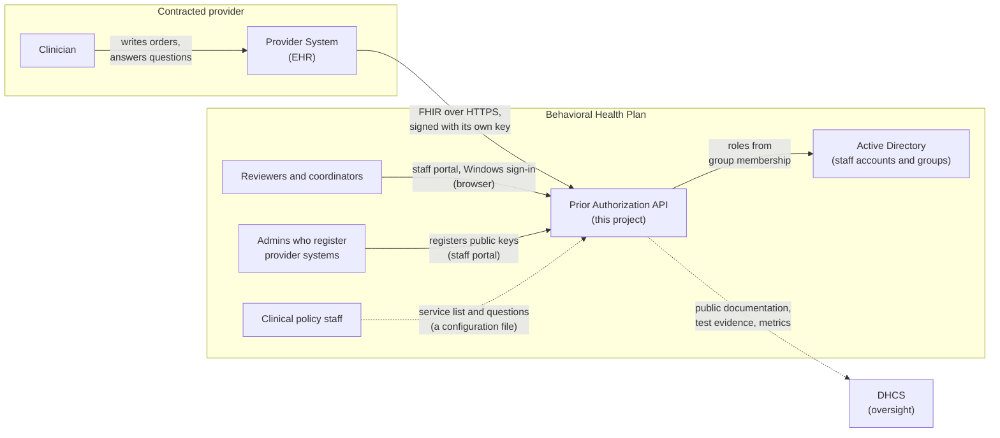
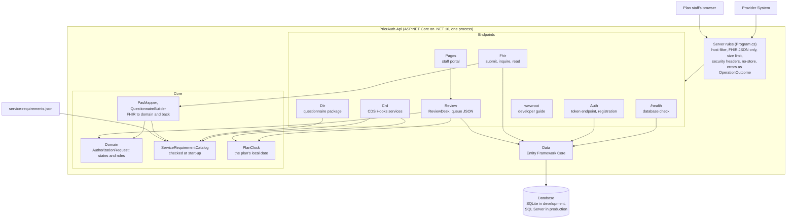
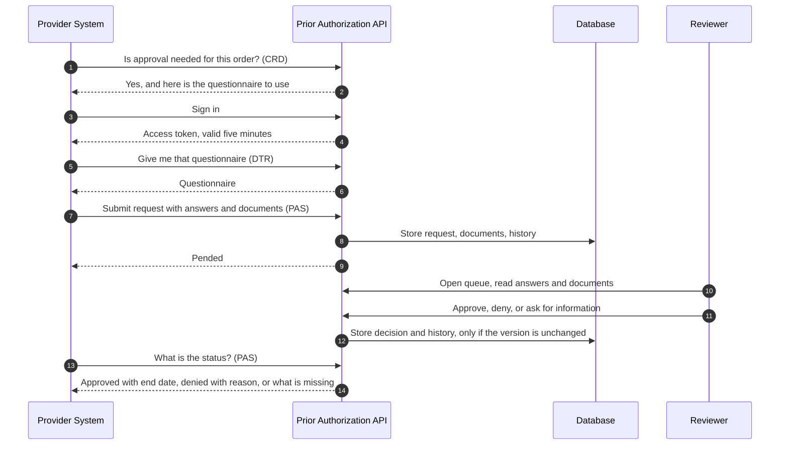
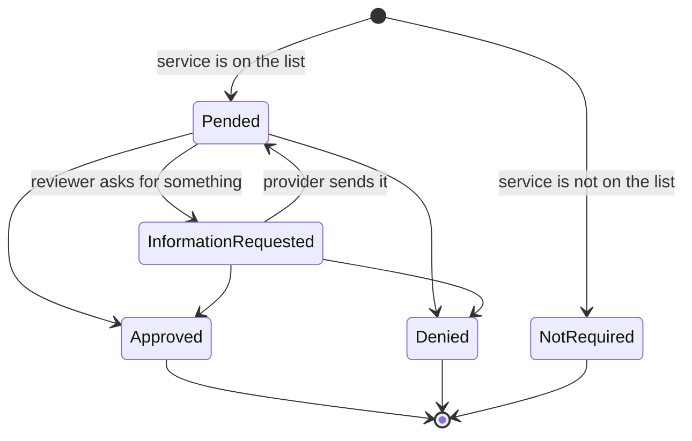
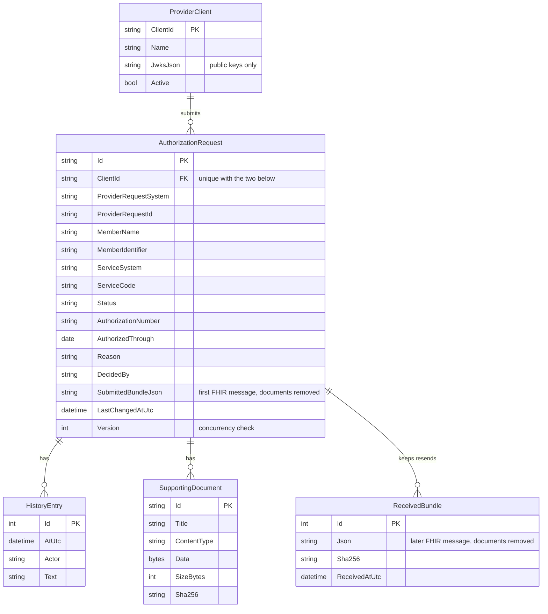
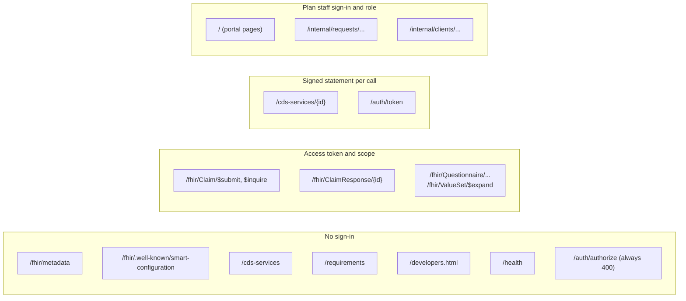
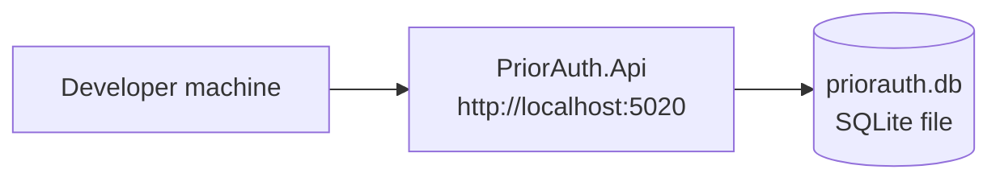
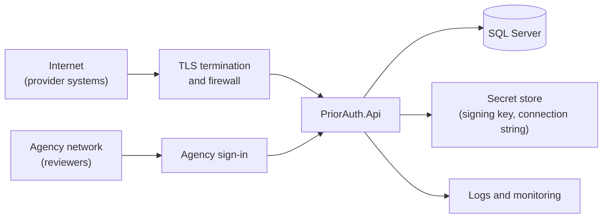

# Architecture overview

This page is the map of the whole system on one page: who uses it, what it is made of, how a request moves through it, what is stored, how access is controlled, and what is not yet built. The numbered guides go deeper on each part and are linked where they apply.

Last updated 2026-11-11.

## 1. What the system is

The Prior Authorization API lets a contracted provider's software ask the county's Medi-Cal behavioral health plan for approval before delivering a service, and get the plan's answer, without fax or phone. The plan is the payer, so this project is the server side.

It is one ASP.NET Core application with one database. It answers three questions, each with its own healthcare standard:

| Question | Standard | Built on |
|---|---|---|
| Does this service need approval? | Da Vinci CRD | CDS Hooks |
| What do you need to know? | Da Vinci DTR | FHIR Questionnaire |
| Here is my request; what is your answer? | Da Vinci PAS | FHIR Claim and ClaimResponse |

A person at the plan decides every request. The system never approves or denies on its own.

## 2. Who and what it talks to

Solid lines exist in the software today. Dotted lines are done by hand or not built: policy staff supply a file, and nothing is reported to DHCS automatically.

| Actor | What they do | How |
|---|---|---|
| Provider System | Asks about orders, downloads questionnaires, submits requests, checks status | The provider-facing API |
| Clinician | Writes the order and answers the questionnaire | Inside their own EHR, never in this system |
| Reviewer | Reads requests and documents, then approves, denies or asks for information | The reviewer queue page |
| Registration staff | Register a provider's public key and switch a provider off | Internal endpoints |
| Clinical policy staff | Decide which services need approval, the paperwork and the questions | Edit `service-requirements.json` |

The system does not connect to an eligibility system, a claims system, or the plan's EHR. That is a limit, described in section 9.

## 3. What it is made of

The code is organized by what each part is for:

| Folder | Responsibility | Depends on |
|---|---|---|
| [Domain](../src/PriorAuth.Api/Domain) | The authorization request, its states and every business rule; the service list and its start-up checks; the plan's calendar. Knows nothing about HTTP or the database (the service list reads FHIR codings to match a code). | Nothing |
| [Fhir](../src/PriorAuth.Api/Fhir) | PAS endpoints, reading and writing FHIR JSON, translating between FHIR and the domain | Domain, Data, Auth |
| [Crd](../src/PriorAuth.Api/Crd) | CDS Hooks discovery and the two order services | Domain, Auth, Dtr |
| [Dtr](../src/PriorAuth.Api/Dtr) | Builds questionnaires from the service list and serves them | Domain, Auth |
| [Review](../src/PriorAuth.Api/Review) | `ReviewDesk` (every staff action on a request), the queue as JSON, decisions and document download | Domain, Data, Auth (who is signed in, the staff policies) |
| [Pages](../src/PriorAuth.Api/Pages) | The staff portal: queue, request, provider systems, no-access and test-user sign-in. Asks the domain which actions to offer; acts through `ReviewDesk`. | Domain, Review, Auth, Data |
| [Auth](../src/PriorAuth.Api/Auth) | Registration of provider systems, the token endpoint, token checks; staff sign-in and roles | Data, Domain |
| [Data](../src/PriorAuth.Api/Data) | Database mapping and migrations | Domain, Auth |
| [wwwroot](../src/PriorAuth.Api/wwwroot) | The developer guide, as a static file | Nothing |

The rule that keeps this maintainable: **business rules live only in `Domain`**. An endpoint may refuse a malformed message, but whether a request can be approved, denied or changed is decided by `AuthorizationRequest` and nowhere else. That includes who may do what: a coordinator cannot approve, only a physician decides a concurrent review, and a request claimed by one person cannot be decided by another. That is why the same rules hold whether a decision arrives from the portal, the JSON endpoints or any future caller.

Other projects in the repository:

| Project | Purpose |
|---|---|
| [tests/PriorAuth.Api.Tests](../tests/PriorAuth.Api.Tests) | 190 automated tests; nearly all start the real app and call it over HTTP, on SQLite or SQL Server |
| [samples/PriorAuth.ClinicDemo](../samples/PriorAuth.ClinicDemo) | A browser demo that behaves like a provider system, end to end |

## 4. How a request moves through it

A request is known by the provider system that sent it plus the system and value of its identifier. Sending the same identifier again returns the current answer; reusing it for another member or service is refused with 422. Asking about an identifier that matches nothing returns an empty result, not an error. Two people acting on one request at the same moment cannot both win: the second gets 409 and must reload.

A request is always in one of five states:

The provider learns the decision by asking. The system does not push notifications; reading a response by id returns an `ETag`, so asking again with `If-None-Match` costs a 304 until something changes. Details: [How it works](02-how-it-works.md) and [CRD and DTR](06-crd-and-dtr.md).

## 5. What is stored

| What | Where | Notes |
|---|---|---|
| Requests, decisions, history, documents, registered provider systems | The database | Member information is in here. It is protected health information in real use. |
| The original FHIR message of each request | A column on the request | Kept as a record and so responses can echo the right references. Document contents are removed, because each document is stored once on its own. |
| Later FHIR messages sent under the same identifier | `ReceivedBundle` table | Each different one kept once, for the record |
| The service list, paperwork and questions | `service-requirements.json` | Loaded at start-up. A change needs a restart. |
| Access-token signing key | Memory | Created at start-up, lost on restart |
| Record of sign-in statements already used | Memory | Per process |

Nothing is deleted or archived by the system. A retention policy does not exist yet.

## 6. Who is allowed to do what

| Zone | Rule | Why |
|---|---|---|
| No sign-in | Open to anyone | These only describe the server or plan policy. No member data. |
| Access token | A five-minute token from `/auth/token`, carrying the right scope | Standard SMART Backend Services |
| Signed statement | A short statement signed with the provider system's private key, made for that exact address, used once | How sign-in itself works, and what CDS Hooks requires on each call |
| Plan staff sign-in and role | Windows Integrated Authentication (Kerberos or NTLM); roles from the plan's Active Directory groups. The portal's forms carry an anti-forgery token; changes under `/internal` also need the `X-Requested-By` header. In Development a page to pick a test user stands in, and start-up refuses it anywhere else. | Staff are identified by the account they already use, and the plan manages access through groups it already has. |

The controls that matter most:

- **No shared secrets.** A provider system proves itself with a private key it never sends. The plan stores public keys only (RSA of at least 2048 bits or EC P-384, each with its own `kid`), and refuses a registration that contains a private or symmetric key.
- **A switched-off provider is out at once.** A deactivated client's existing tokens are refused on the next call.
- **Each provider system sees only its own requests.** Another provider's request is reported as not found.
- **The recorded provider name is the registered one**, not the name a request claims.
- **Uploaded files are restricted.** Only PDF, JPEG, PNG, TIFF and plain text, up to 5 MB each and 10 per request, always served to reviewers as a download.
- **The server boundary is narrow.** Only the configured host names are answered (`AllowedHosts`). The FHIR API refuses non-JSON with 406 or 415. Every response carries a Content Security Policy, `X-Frame-Options: DENY`, `nosniff` and `no-referrer`; responses that can hold member data are marked `no-store`. Errors from `/fhir` are `OperationOutcome` resources with no internal detail.

Details: [Sign-in for provider systems](05-sign-in.md).

## 7. Technology

| Concern | Choice | Reason |
|---|---|---|
| Runtime | .NET 10, ASP.NET Core minimal APIs | The agency's stack; long-term support release |
| FHIR | Firely SDK (`Hl7.Fhir.R4` 6.8) | The established .NET library. It parses strictly and rejects malformed resources. |
| Database access | Entity Framework Core 10 | Migrations for SQL Server; SQLite for local work with no setup |
| Tokens | `Microsoft.IdentityModel.JsonWebTokens`, ASP.NET Core JWT bearer | Standard, maintained JWT handling |
| Tests | xUnit with `WebApplicationFactory` | Tests run the real app over HTTP, on SQLite or SQL Server |
| Staff portal | ASP.NET Core Razor Pages, server-rendered, no JavaScript framework | No build step; works with Windows sign-in in the browser; one project to deploy |
| Staff sign-in | Windows Integrated Authentication (`Microsoft.AspNetCore.Authentication.Negotiate`), roles from AD groups | The plan already runs Active Directory; no new accounts or passwords |

Standards targeted: FHIR R4.0.1, Da Vinci PAS, CRD and DTR at STU 2.0.1, SMART Backend Services, CDS Hooks.

## 8. How it runs

Today it runs only on a developer's machine:

A production deployment has not been designed. What it will need, at minimum:

Everything in the second diagram except the application and SQL Server support is still to be decided or built. Configuration that already exists for it:

| Setting | Purpose |
|---|---|
| `Database:Provider` | `Sqlite` or `SqlServer` |
| `ConnectionStrings:PriorAuth` | The database connection |
| `Auth:PublicBaseUrl` | The public https address. Token audiences and published addresses use it, never the caller's `Host` header. Outside Development the application will not start without it. |
| `AllowedHosts` | The host names the server answers to. The default is `localhost;127.0.0.1;[::1]`, so a deployment must set its public host name or every outside request is refused. |
| `Plan:TimeZone` | The plan's time zone for "today" (default `America/Los_Angeles`). An unknown zone stops start-up. |
| `Plan:Name` | The plan name shown on CRD cards |

On SQL Server the application applies its migrations when it starts. It also refuses to start if `service-requirements.json` has a mistake. `GET /health` reports whether the database answers, for the hosting platform's monitoring.

## 9. Decisions and their consequences

| Decision | Consequence |
|---|---|
| A person decides every request | The first answer is nearly always "pended", and providers must ask again for the result. No clinical logic lives in code. |
| This service is the system of record | It owns requests, decisions and documents. This was assumed, not confirmed; see [open questions](04-status-and-open-questions.md). |
| FHIR only, no X12 278 | Simpler, and permitted by CMS enforcement discretion. Providers that only speak X12 cannot use it. |
| One application, one database | Easy to run and reason about. It cannot yet run as more than one instance. |
| Service list in a file, not a database | Policy staff can change it without code, but a change needs a restart and there is no editing screen or change history beyond version control. |
| Documents stored in the database | Simple and transactional. Large volumes would be better in file or blob storage. |
| Provider systems pull; nothing is pushed | No outbound connections to providers to secure. Decisions are not delivered until asked for. Subscriptions are deliberately not built. |
| One service per request | A Claim with several lines is refused rather than half reviewed. Providers send one request per service. |
| Optimistic concurrency on each request | No locks are held while a reviewer reads. A decision made on an out-of-date copy is refused with 409. |
| Dates in the plan's time zone | Approvals, authorization numbers and CRD answers use the local date. Exact moments are still stored in UTC. |

## 10. What is not built

These are the gaps that matter at the level of architecture. The full list with issue links is in [Status and open questions](04-status-and-open-questions.md), and the audit of 2026-11-11 against the CMS Prior Authorization API workflow is in [7. November 2026 audit](07-audit-2026-11.md).

| Gap | Effect |
|---|---|
| Audit log of access | Who read which request is not logged for review. The system must not hold real data until this exists. |
| Eligibility | The system does not know whether a member is enrolled. |
| Conformance testing | Response Bundles were checked once with a validator during the audit, but no validator runs in the build and no Inferno run has been made. US Core / USCDI conformance of incoming resources is not checked. Interoperability with a real EHR is unproven. |
| Automatic answers in questionnaires | A person types every answer. |
| Hosting, TLS, backups, monitoring, audit log export | Nothing is deployed. A `/health` check exists. |
| Malware scanning of uploads | Files are restricted by type and size only. |
| More than one server instance | The token signing key is created at start-up and the replay memory is per process. |
| Decision timeframes and priority | The rule sets 72 hours for expedited and 7 days for standard requests. Priority is not recorded, and nothing tracks or warns on these. |
| Public metrics and DHCS reporting | Not produced. |
| Appeals | Not recorded; a denial is final in this system. |
| Partial approval and coded denial reasons | A request is approved or denied whole, with a free-text reason. |
| PAS update and cancel | Not supported; such a request is refused. |
| Patient Access and Provider Access APIs | Prior authorization data is not shared with them. |
| 42 CFR Part 2 | Substance use disorder records get no special consent or redisclosure handling. |
| CORS | Not enabled; browser-based provider applications cannot call the API directly. |
| Confirmed service list | The list follows the DHCS notices, but some codes and all questionnaires await the plan's confirmation ([9. The service list](09-service-list.md)). |

## Where to go next

| To understand | Read |
|---|---|
| Why this exists and the vocabulary | [1. Overview](01-overview.md) |
| The request rules, code map and FHIR mapping in detail | [2. How it works](02-how-it-works.md) |
| Running it and the full endpoint list | [3. Running and testing](03-running-and-testing.md) |
| What is done, missing and assumed | [4. Status and open questions](04-status-and-open-questions.md) |
| Sign-in | [5. Sign-in for provider systems](05-sign-in.md) |
| CRD and DTR | [6. Asking first: CRD and DTR](06-crd-and-dtr.md) |
| What the November 2026 audit found | [7. November 2026 audit](07-audit-2026-11.md) |
| How the code is built, class by class, and how to change it safely | [8. Codebase guide for developers](08-codebase-guide.md) |
