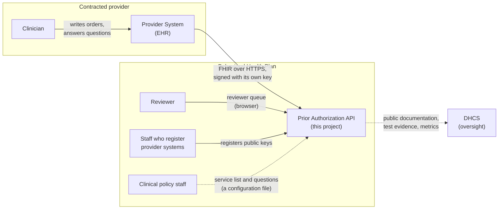
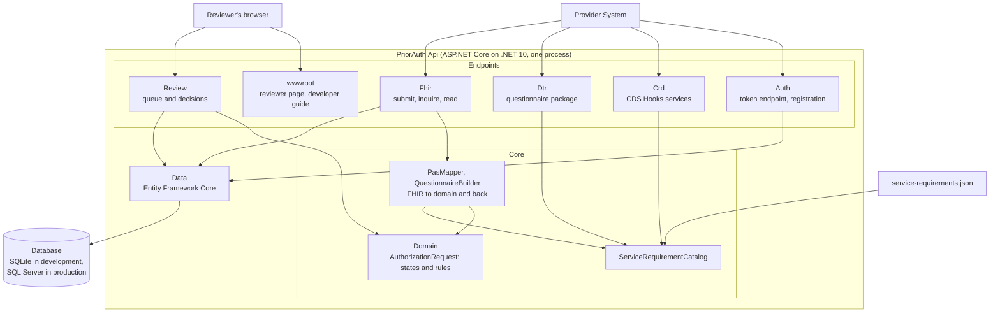
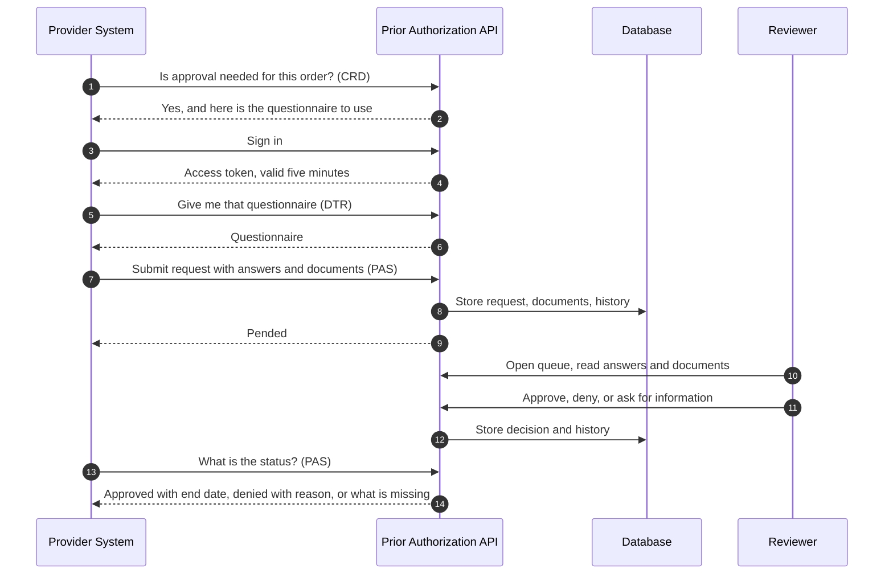
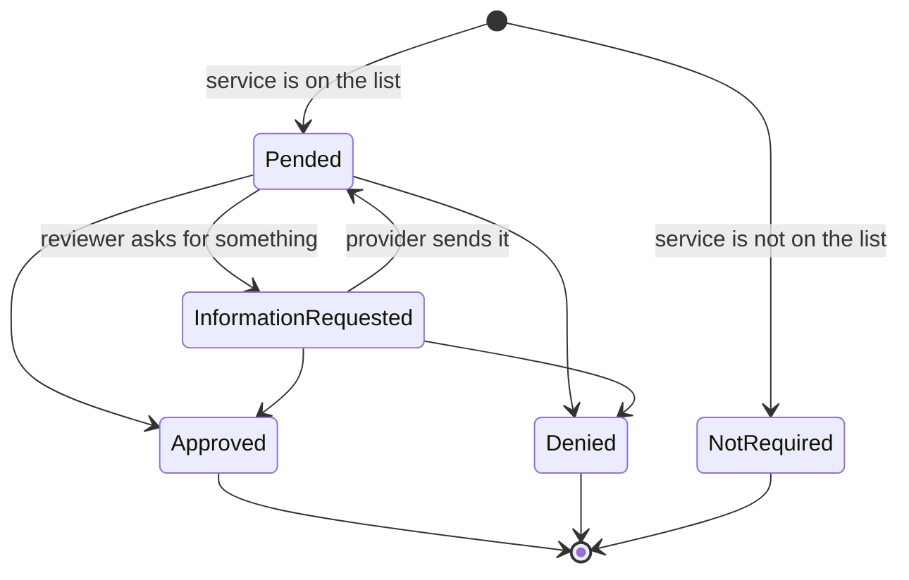
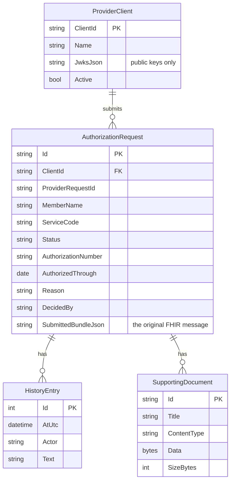
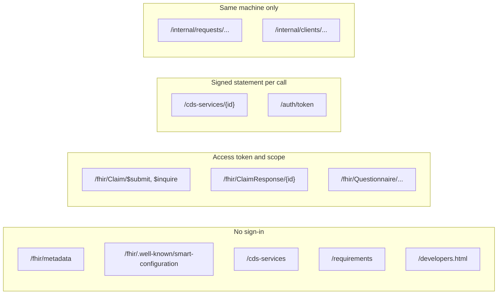
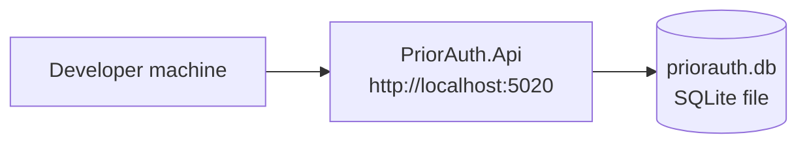
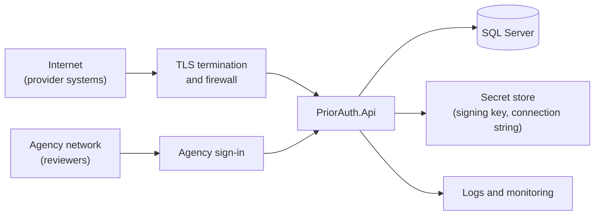

# Architecture overview

This page is the map of the whole system on one page: who uses it, what it is made of, how a request moves through it, what is stored, how access is controlled, and what is not yet built. The numbered guides go deeper on each part and are linked where they apply.

Last updated 2026-11-11.

## 1. What the system is

The Prior Authorization API lets a contracted provider's software ask the county's Medi-Cal behavioral health plan for approval before delivering a service, and get the plan's answer, without fax or phone. The plan is the payer, so this project is the server side.

It is one ASP.NET Core application with one database. It answers three questions, each with its own healthcare standard:

| Question | Standard | Built on |
|---|---|---|
| Does this service need approval? | Da Vinci CRD | CDS Hooks |
| What do you need to know? | Da Vinci DTR | FHIR Questionnaire |
| Here is my request; what is your answer? | Da Vinci PAS | FHIR Claim and ClaimResponse |

A person at the plan decides every request. The system never approves or denies on its own.

## 2. Who and what it talks to

Solid lines exist in the software today. Dotted lines are done by hand or not built: policy staff supply a file, and nothing is reported to DHCS automatically.

| Actor | What they do | How |
|---|---|---|
| Provider System | Asks about orders, downloads questionnaires, submits requests, checks status | The provider-facing API |
| Clinician | Writes the order and answers the questionnaire | Inside their own EHR, never in this system |
| Reviewer | Reads requests and documents, then approves, denies or asks for information | The reviewer queue page |
| Registration staff | Register a provider's public key and switch a provider off | Internal endpoints |
| Clinical policy staff | Decide which services need approval, the paperwork and the questions | Edit `service-requirements.json` |

The system does not connect to an eligibility system, a claims system, or the plan's EHR. That is a limit, described in section 9.

## 3. What it is made of

The code is organized by what each part is for:

| Folder | Responsibility | Depends on |
|---|---|---|
| [Domain](../src/PriorAuth.Api/Domain) | The authorization request, its states and every business rule. Knows nothing about FHIR, HTTP or the database. | Nothing |
| [Fhir](../src/PriorAuth.Api/Fhir) | PAS endpoints, reading and writing FHIR JSON, translating between FHIR and the domain | Domain, Data, Auth |
| [Crd](../src/PriorAuth.Api/Crd) | CDS Hooks discovery and the two order services | Domain, Auth, Dtr |
| [Dtr](../src/PriorAuth.Api/Dtr) | Builds questionnaires from the service list and serves them | Domain, Auth |
| [Review](../src/PriorAuth.Api/Review) | The reviewer queue, decisions and document download | Domain, Data |
| [Auth](../src/PriorAuth.Api/Auth) | Registration of provider systems, the token endpoint, token checks | Data |
| [Data](../src/PriorAuth.Api/Data) | Database mapping and migrations | Domain, Auth |
| [wwwroot](../src/PriorAuth.Api/wwwroot) | The reviewer page and the developer guide, as static files | Nothing |

The rule that keeps this maintainable: **business rules live only in `Domain`**. An endpoint may refuse a malformed message, but whether a request can be approved, denied or changed is decided by `AuthorizationRequest` and nowhere else. That is why the same rules hold whether a decision arrives from the reviewer page or any future caller.

Other projects in the repository:

| Project | Purpose |
|---|---|
| [tests/PriorAuth.Api.Tests](../tests/PriorAuth.Api.Tests) | 65 integration tests that start the real app and call it over HTTP |
| [samples/PriorAuth.SampleClient](../samples/PriorAuth.SampleClient) | A console program that behaves like a provider system, end to end |
| [prototype/PriorAuth.Prototype](../prototype/PriorAuth.Prototype) | The original throwaway learning prototype. Not part of the service. |

## 4. How a request moves through it

A request is always in one of five states:

The provider learns the decision by asking. The system does not push notifications. Details: [How it works](02-how-it-works.md) and [CRD and DTR](06-crd-and-dtr.md).

## 5. What is stored

| What | Where | Notes |
|---|---|---|
| Requests, decisions, history, documents, registered provider systems | The database | Member information is in here. It is protected health information in real use. |
| The original FHIR message of each request | A column on the request | Kept as received, as a record and so responses can echo the right references |
| The service list, paperwork and questions | `service-requirements.json` | Loaded at start-up. A change needs a restart. |
| Access-token signing key | Memory | Created at start-up, lost on restart |
| Record of sign-in statements already used | Memory | Per process |

Nothing is deleted or archived by the system. A retention policy does not exist yet.

## 6. Who is allowed to do what

| Zone | Rule | Why |
|---|---|---|
| No sign-in | Open to anyone | These only describe the server or plan policy. No member data. |
| Access token | A five-minute token from `/auth/token`, carrying the right scope | Standard SMART Backend Services |
| Signed statement | A short statement signed with the provider system's private key, made for that exact address, used once | How sign-in itself works, and what CDS Hooks requires on each call |
| Same machine only | Answers only callers on the server itself | A stopgap. Staff sign-in is not built. |

Four controls matter most:

- **No shared secrets.** A provider system proves itself with a private key it never sends. The plan stores public keys only, and refuses a registration that contains a private key.
- **Each provider system sees only its own requests.** Another provider's request is reported as "not found".
- **The recorded provider name is the registered one**, not the name a request claims.
- **Uploaded files are restricted.** Only PDF, JPEG, PNG, TIFF and plain text, up to 5 MB each, always served to reviewers as a download.

Details: [Sign-in for provider systems](05-sign-in.md).

## 7. Technology

| Concern | Choice | Reason |
|---|---|---|
| Runtime | .NET 10, ASP.NET Core minimal APIs | The agency's stack; long-term support release |
| FHIR | Firely SDK (`Hl7.Fhir.R4` 6.8) | The established .NET library. It parses strictly and rejects malformed resources. |
| Database access | Entity Framework Core 10 | Migrations for SQL Server; SQLite for local work with no setup |
| Tokens | `Microsoft.IdentityModel.JsonWebTokens`, ASP.NET Core JWT bearer | Standard, maintained JWT handling |
| Tests | xUnit with `WebApplicationFactory` | Tests run the real app over HTTP, on SQLite or SQL Server |
| Reviewer page | One static HTML file with plain JavaScript | No build step; replaceable later |

Standards targeted: FHIR R4.0.1, Da Vinci PAS, CRD and DTR at STU 2.0.1, SMART Backend Services, CDS Hooks.

## 8. How it runs

Today it runs only on a developer's machine:

A production deployment has not been designed. What it will need, at minimum:

Everything in the second diagram except the application and SQL Server support is still to be decided or built. Configuration that already exists for it:

| Setting | Purpose |
|---|---|
| `Database:Provider` | `Sqlite` or `SqlServer` |
| `ConnectionStrings:PriorAuth` | The database connection |
| `Auth:PublicBaseUrl` | The public address, needed behind a proxy so that token audiences and questionnaire addresses are correct |

On SQL Server the application applies its migrations when it starts.

## 9. Decisions and their consequences

| Decision | Consequence |
|---|---|
| A person decides every request | The first answer is nearly always "pended", and providers must ask again for the result. No clinical logic lives in code. |
| This service is the system of record | It owns requests, decisions and documents. This was assumed, not confirmed; see [open questions](04-status-and-open-questions.md). |
| FHIR only, no X12 278 | Simpler, and permitted by CMS enforcement discretion. Providers that only speak X12 cannot use it. |
| One application, one database | Easy to run and reason about. It cannot yet run as more than one instance. |
| Service list in a file, not a database | Policy staff can change it without code, but a change needs a restart and there is no editing screen or change history beyond version control. |
| Documents stored in the database | Simple and transactional. Large volumes would be better in file or blob storage. |
| Provider systems pull; nothing is pushed | No outbound connections to providers to secure. Decisions are not delivered until asked for. |

## 10. What is not built

These are the gaps that matter at the level of architecture. The full list with issue links is in [Status and open questions](04-status-and-open-questions.md).

| Gap | Effect |
|---|---|
| Staff sign-in | Reviewers and registration staff are not identified. The system must not hold real data until this exists. |
| Eligibility | The system does not know whether a member is enrolled. |
| Conformance testing | No validator or Inferno run has been made. Interoperability with a real EHR is unproven. |
| Automatic answers in questionnaires | A person types every answer. |
| Hosting, TLS, backups, monitoring, audit log export | Nothing is deployed. |
| Malware scanning of uploads | Files are restricted by type and size only. |
| More than one server instance | Signing key and replay memory are per process. |
| Decision timeframes | The rule sets 72 hours for expedited and 7 days for standard requests. Nothing tracks or warns on these. |
| Public metrics and DHCS reporting | Not produced. |
| Patient Access API | Prior authorization data is not shared with it. |
| Real service list | The four services and their questions are invented placeholders. |

## Where to go next

| To understand | Read |
|---|---|
| Why this exists and the vocabulary | [1. Overview](01-overview.md) |
| The request rules, code map and FHIR mapping in detail | [2. How it works](02-how-it-works.md) |
| Running it and the full endpoint list | [3. Running and testing](03-running-and-testing.md) |
| What is done, missing and assumed | [4. Status and open questions](04-status-and-open-questions.md) |
| Sign-in | [5. Sign-in for provider systems](05-sign-in.md) |
| CRD and DTR | [6. Asking first: CRD and DTR](06-crd-and-dtr.md) |
